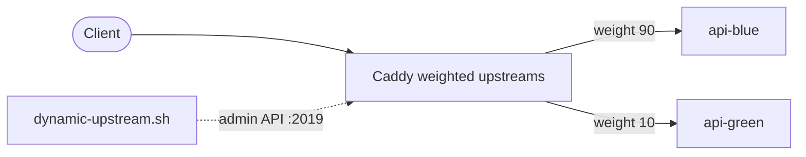

# ADR-008: Blue-green deployment with Caddy upstreams

## Status

Accepted

## Context

Application releases must not drop in-flight requests. A naive deploy stops the old container, builds and starts the new one, and routes again — a window of downtime and an all-or-nothing cutover with no safe way to check the new version under real traffic before committing to it.

We also need a rollback that is measured in seconds, not in a redeploy, and ideally a way to expose a new version to a small slice of traffic first (canary) before shifting everything.

## Decision

Use **weighted upstreams in Caddy** to implement blue-green (and percentage-based canary) deployments.

- Caddy's `upstreams.conf` defines blue and green upstreams for each application service, and `lb_policy weighted` distributes requests according to their weights.
- A single environment variable, `DEPLOY_VERSION`, describes the intended split:

  | `DEPLOY_VERSION` | blue weight | green weight | Effect                      |
  | ---------------- | ----------- | ------------ | --------------------------- |
  | `blue`           | 100         | 0            | Blue is live, green is idle |
  | `green`          | 0           | 100          | Green is live, blue is idle |
  | `canary:10`      | 90          | 10           | 10% of traffic to green     |

- `scripts/deploy/dynamic-upstream.sh` performs the cutover by **rewriting upstream weights through Caddy's admin API** (`127.0.0.1:2019`) at runtime. It does not rewrite files or restart Caddy.
- Operators drive it through recipes: `just dynamic-upstream <slot> <weight>`, `just deployment-status`, and `just rollback`.
- Rollback is a weight change back to the previous slot — instantaneous, because it is a config mutation and not a container lifecycle operation.
- Canary rollouts step the weight up gradually while SigNoz observes error rate and p99 latency; the pipeline auto-aborts and reverts if error rate exceeds 1% or p99 grows by more than 50%.

## Consequences

### Positive

- **Zero-downtime cutover**: traffic shifts by weight change, so no request is sent to a slot mid-startup.
- **Fast rollback**: reverting is a single admin-API call, not a redeploy.
- **Gradual exposure**: canary percentages let a new version prove itself on a fraction of traffic.
- **No restart**: Caddy keeps serving throughout, preserving warm connections.

### Negative

- **Two slots to run**: during a release both versions are deployed, doubling the resource footprint for that service until the old slot is retired.
- **External state**: the live weights are held in the Caddy config, not in the repository, so the running split must be inspected with `just deployment-status`.
- **Routing indirection**: understanding which version serves traffic requires reading Caddy state, not just the Compose files.

### Risks

- **Stale slot**: a slot left running after a cutover wastes resources and can mask drift. Deployment tooling and post-deploy verification (health checks on the active slot) mitigate this.
- **Admin API exposure**: anyone able to reach `:2019` could redirect all traffic. The API is bound to loopback only.
- **Stateful coupling**: blue-green assumes application instances are stateless between releases. Schema changes must remain backward-compatible across both slots; destructive migrations are a separate, coordinated step.

## References

- Deployment model: `docs/architecture/deployment-model.md`
- Runbook: `docs/runbooks/deploy/blue-green-switch.md`
- Script: `scripts/deploy/dynamic-upstream.sh`
- Reverse proxy: ADR-007 · HA topology: ADR-010, ADR-011
