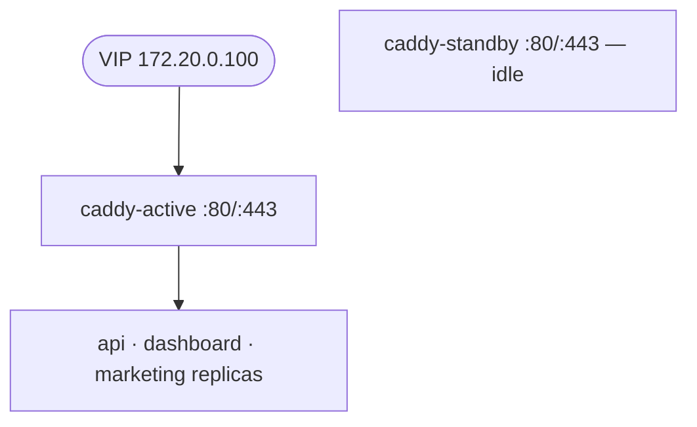

# ADR-010: Caddy active-standby (no load balancing)

## Status

Accepted

## Context

Production runs two Caddy instances so that ingress survives the failure of one (ADR-011). There are two ways to use a pair:

- **Active-active** — both instances serve traffic simultaneously, with a load balancer in front. This raises throughput and uses both nodes, but it needs a shared state strategy for anything per-instance: rate-limit counters, ACME challenge state, and (for sticky routing) client affinity. It also makes reasoning about "which node answered" harder during incidents.
- **Active-standby** — one instance serves all traffic and the other sits idle with an identical configuration, ready to take over. One node is "wasted" in normal operation, but there is only ever one source of truth for ingress state.

At this scale, ingress throughput is not the bottleneck — TLS termination and host-based routing are cheap, and application load balancing already happens at the Caddy→app layer via Docker's DNS.

## Decision

Run the two Caddy instances in **active-standby** mode. Do **not** load-balance between them.

- `caddy-active` serves all inbound traffic; `caddy-standby` runs the same image, mounts the **same** Caddyfile and snippets, and is idle until failover.
- The floating VIP is owned by a single instance at a time, managed by Keepalived (ADR-011). Only the VIP holder receives traffic.
- Both instances are cross-attached to `edge` and `backend` so the standby can begin proxying immediately on promotion.
- Load balancing across application replicas (`least_conn`) happens **inside** each Caddy via Docker's service DNS — three API/Dashboard/Marketing replicas in prod — and is independent of the HA topology above it.

## Consequences

### Positive

- **Single writer for ingress state**: no need to share or replicate rate-limit counters or ACME state between nodes.
- **Configuration parity is trivial**: both nodes mount the same files, so the standby is a faithful copy.
- **Simple failure model**: if the active instance is unhealthy, the VIP moves and the standby serves — there is no partial-failure state where only half the traffic is degraded.
- **Wasted capacity is negligible**: ingress is not the constrained resource.

### Negative

- **Idle standby**: one node contributes no capacity in normal operation.
- **Per-instance state resets on failover**: rate-limit counters are per-process, so after a failover the standby starts with a fresh counter. This is documented and accepted.
- **No graceful draining**: the standby does not share load, so failover moves _all_ connections at once (mitigated by Keepalived's fast detection and short-lived HTTP connections).

### Risks

- **Both nodes unhealthy**: if both Caddy instances fail, ingress is down regardless of VIP ownership. Combined health checks (ADR-011) and alerts on Caddy health are the mitigation.
- **Config drift**: a hand-edited file on one node breaks parity. Configuration lives in git and is mounted read-only; nodes are recreated from the same source.

## References

- Caddy service: `docs/services/caddy.md`
- Reverse proxy choice: ADR-007 · Failover: ADR-011 · Blue-green (app-level, not node-level): ADR-008
