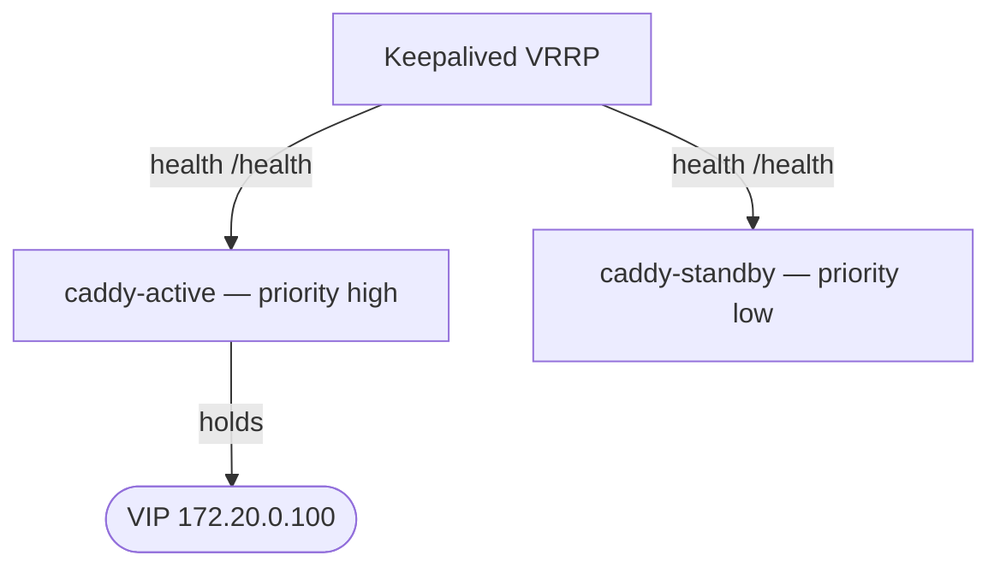

# ADR-011: Keepalived health checks for both Caddys

## Status

Accepted

## Context

The ingress pair (ADR-010) needs automatic failover: when the active Caddy stops serving, the standby must take over without human intervention and within a bound that clients tolerate. A floating virtual IP (VIP) is the standard mechanism — clients always connect to the VIP, and the VIP moves to whichever node is healthy.

Two details determine whether failover is _correct_:

1. **What is health-checked.** A node whose Caddy process is alive but whose HTTP listener is broken (bad config, exhausted resources, failed ACME) must not hold the VIP. Liveness of the process is not enough; the check must exercise the HTTP path.
2. **Both nodes must be monitored.** If only the active node is watched, a standby that failed silently would be promoted during a real failover and immediately fail too.

## Decision

Use **Keepalived** (VRRP) to manage a floating VIP, health-checking **both** Caddy instances.

- **VIP**: `172.20.0.100/24`, inside the edge subnet (ADR-005).
- **Topology**: `keepalived` runs in host network mode (required to bind the VIP to a physical interface) with `NET_ADMIN`, `NET_BROADCAST`, and `NET_RAW` capabilities.
- **HTTP health checks**: Keepalived probes `http://<caddy>/health` on both `caddy-active` and `caddy-standby`. A tracked check lowers the failing node's priority below the healthy node's, so the VIP moves.
- **Failover target**: < 5 seconds under normal conditions.
- **Split-brain prevention**: VRRP authentication plus priority-based election ensures only one node advertises and holds the VIP.
- **Interface resolution**: the VRRP interface name is host-specific and resolved at setup time by `docker/init/resolve-vrrp-interface.sh` (run via `just setup-prod`), which writes the final configuration. A template is kept at `docker/config/keepalived/keepalived.conf.template`; the resolved file is bind-mounted read-only.
- **Dev/staging**: Keepalived is not deployed; there is a single Caddy instance and no VIP.

## Consequences

### Positive

- **Application-level accuracy**: because the check is an HTTP probe of `/health`, a broken Caddy is detected even if its process is running.
- **No silent-standby failure**: monitoring both nodes means a failover only happens to a node known to be healthy.
- **Fast recovery**: sub-five-second failover keeps client impact to a brief connection interruption.
- **No manual step**: VIP migration is automatic.

### Negative

- **Host coupling**: host network mode and NET_* capabilities mean Keepalived is not portable to environments that forbid them; it is production-only by design.
- **Interface-specific config**: the VRRP interface must be resolved per host, so the config cannot be fully static.
- **Two sources of health**: the same `/health` probe drives both Docker dependency ordering and Keepalived decisions; the endpoint must stay cheap and accurate.

### Risks

- **Split-brain under partition**: if the nodes lose sight of each other, both could try to hold the VIP. VRRP authentication and priority election prevent this in practice; a network partition is a documented incident runbook.
- **Flapping**: a marginally unhealthy node can cause repeated failovers. Hysteresis in Keepalived's check configuration and alerts on failover events mitigate this.
- **VIP not reclaimed prematurely**: after failover, the original active must pass its checks before reclaiming the VIP on a later election cycle.

## References

- Keepalived service: `docs/services/keepalived.md`
- Caddy service: `docs/services/caddy.md`
- Config: `docker/config/keepalived/` · Interface resolver: `docker/init/resolve-vrrp-interface.sh`
- HA design: ADR-010 · Network ranges: ADR-004, ADR-005
