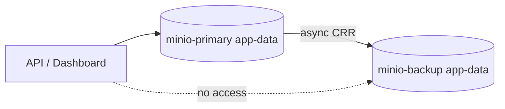

# ADR-016: MinIO versioning and CRR to minio-backup

## Status

Accepted

## Context

Object storage holds uploads and assets that are not reconstructable from the database. A single MinIO instance — one container, one volume — is a single point of failure: a bad delete, an application bug, or loss of the host takes the objects with it.

The platform needs:

1. **Protection against destructive writes** — an accidental overwrite or delete must be recoverable.
2. **A copy outside the primary failure domain** — so that loss of the primary host does not lose the data.
3. **A path back** — a documented way to promote the copy or restore from it.

## Decision

Enable **bucket versioning** on the primary bucket and, in production, replicate to a second MinIO instance.

- **Versioning**: `app-data` is versioned, so an overwrite creates a new version and a delete is a soft delete. Prior versions remain recoverable.
- **Cross-region replication (CRR)**: production deploys `minio-backup` as an asynchronous replication target:

  ```bash
  mc replicate add minio-primary/app-data minio-backup/app-data
  ```

- **Isolation**: `minio-backup` runs on the `infrastructure` network with **no published ports** and is not directly reachable by applications.
- **Restore path**: `scripts/restore/restore-minio.sh` can promote the backup instance or mirror objects back; the procedure is documented in the data-operations runbooks.
- **Scheduling**: replication is configured by the idempotent `init-minio` job alongside bucket and policy setup (ADR-012, ADR-015).



## Consequences

### Positive

- **Recoverable deletes/overwrites**: versioning makes destructive writes reversible.
- **Failure-domain separation**: the replica is a distinct instance, so primary-host loss does not lose the objects.
- **No application coupling**: applications never talk to the backup; replication is storage-side.
- **Documented recovery**: a restore/promotion path exists and is rehearsed via runbooks.

### Negative

- **Storage growth**: versioning and replication multiply stored bytes; lifecycle rules and retention must account for it.
- **Eventual consistency**: replication is asynchronous, so a disaster can lose the most recent writes (the replication lag window).
- **Extra component**: another MinIO instance to operate, monitor, and upgrade.

### Risks

- **Replication silently stalled**: if replication breaks, the backup drifts and is only discovered at restore time. Monitoring replication status is required.
- **Version explosion**: without lifecycle rules, versions accumulate indefinitely. The lifecycle policy (ADR-012) and retention are the guard.
- **Both instances on one host**: in a single-host deployment the backup is not a true off-site copy. A genuine off-site target needs a separate host or region.

## References

- MinIO service: `docs/services/minio.md`
- Runbooks: `docs/runbooks/data-operations/backup-minio.md`, `docs/runbooks/data-operations/restore-minio.md`
- Object storage: ADR-012 · Policies: ADR-015
