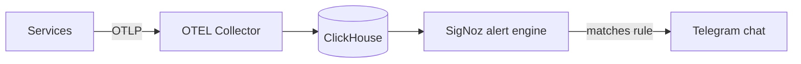

# ADR-018: SigNoz alerting via Telegram

## Status

Accepted

## Context

The observability stack (SigNoz + ClickHouse + OTEL Collector) already collects metrics, traces, and logs. Collection without notification is passive: an operator has to be looking at a dashboard to notice that error rates, latency, or resource usage are out of band.

The platform needs an alert path that:

1. Reaches the on-call person promptly.
2. Is cheap and simple to operate for a small team (no PagerDuty-style vendor).
3. Covers the signals that actually page someone: latency, error rate, saturation, and replication lag.

## Decision

Use **SigNoz's built-in alerting**, delivering notifications to **Telegram**.

- Alert rules are defined and managed in the SigNoz UI/API and stored in SigNoz's metadata database (PostgreSQL via PgBouncer, see ADR-019).
- Categories watched: **latency** (p95 latency over threshold), **error rates** (5xx percentage), **resource saturation** (CPU/memory/disk), and **replication lag** (Redis and PostgreSQL).
- Delivery is configured purely through environment variables — `TELEGRAM_BOT_TOKEN` and `TELEGRAM_CHAT_ID`. Matched alerts are routed to the configured Telegram chat.
- If those variables are unset, alert _delivery_ is disabled while the rules and dashboards continue to work, so local and staging environments do not page anyone.
- SigNoz reads telemetry from ClickHouse and evaluates alert conditions there; the collector and migration jobs that keep that data current are part of the observability module (see `docs/services/clickhouse.md`, `docs/services/otel-collector.md`).

## Consequences

### Positive

- **Low cost and low ops**: a Telegram bot replaces a paging vendor for a small team.
- **Single pane**: alert rules and the dashboards that justify them live in the same tool.
- **Safe defaults**: with no token/chat set, nothing is delivered, so non-production stacks are quiet.
- **Signal-focused**: rules target the four categories that map to real incidents.

### Negative

- **Telegram as delivery channel**: it is not a formal incident-management system — no acknowledgement, escalation, or on-call rotation semantics.
- **Metadata dependency**: alert rules live in the SigNoz metadata DB, so a lost metadata DB means re-creating rules. Covered by Postgres backups.
- **Rule management is not purely declarative**: rules are edited in the UI/API rather than (only) in git, so changes are less reviewable than the rest of the config.

### Risks

- **Alert fatigue**: too many noisy rules train operators to ignore them. Threshold tuning and rule review are ongoing.
- **Silent delivery failure**: an invalid token or revoked chat membership disables delivery without a signal. A periodic test alert and monitoring of the notifier are the mitigation.
- **Token exposure**: the bot token is a credential and follows the tiered secrets strategy (ADR-006).

## References

- SigNoz service: `docs/services/signoz.md`
- ClickHouse service: `docs/services/clickhouse.md`
- Configuration: `.env.example` (`TELEGRAM_BOT_TOKEN`, `TELEGRAM_CHAT_ID`)
- Secret layering: ADR-006 · Cloudflare Tunnel access: ADR-020
