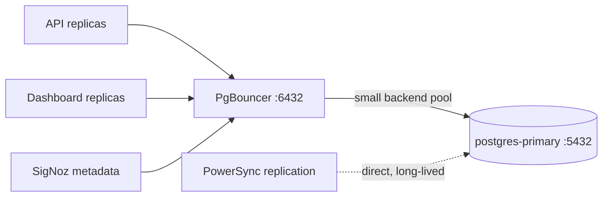

# ADR-019: PgBouncer connection pooling

## Status

Accepted

## Context

PostgreSQL allocates a backend process per connection, so concurrent connections are expensive in memory and scheduling. The platform runs several application services, and in production each has multiple replicas; the observability stack (SigNoz) also keeps a metadata connection to the same database. Add restarts, deploys, and scale events, and the raw connection count can exhaust PostgreSQL's `max_connections` long before CPU or I/O is the bottleneck.

Connecting every service directly to the primary also complicates credential handling and makes connection accounting invisible.

This ADR also resolves ADR-013, which had allowed the Website to bypass pooling with a direct connection.

## Decision

Route all application database traffic through **PgBouncer** in **transaction-mode pooling**.

- **Image**: `pgbouncer/pgbouncer:1.15.0`, on the `infrastructure` network, port **6432**.
- **Transaction mode**: each backend connection is released at the end of every transaction, so a small pool of PostgreSQL backends serves a much larger number of application clients — reducing connection overhead substantially.
- **Authentication**: **SCRAM pass-through** via an `auth_file` (`userlist.txt`). On every stack start the idempotent `pgbouncer-init` one-shot job copies each connecting user's SCRAM verifier verbatim from `pg_authid` into a runtime-generated `userlist.txt` held in a Docker volume. Clients authenticate to PgBouncer via SCRAM against that verifier, and PgBouncer forwards SCRAM to the primary with the same keys.
  - `auth_query` is deliberately **not** used: PgBouncer cannot perform SCRAM pass-through for secrets obtained via `auth_query`.
  - No password material is stored in git.
- **Routing**: API, Dashboard, and SigNoz (metadata) all connect to `pgbouncer:6432`. The `PGBOUNCER_AUTH_USERS` set (e.g. `app,signoz`) determines whose verifiers are mirrored.
- **Credential rotation**: rotate the credential in PostgreSQL/Vault as usual, re-run `pgbouncer-init`, then reload PgBouncer (`docker kill --signal=HUP infra_pgbouncer`) to pick up the regenerated `userlist.txt`.
- **Exception**: PowerSync's logical-replication connection bypasses PgBouncer and connects directly to `postgres-primary:5432`, because replication needs a continuous, long-lived connection that transaction-mode pooling would terminate (ADR-025). This is the only documented exception and is enforced by `scripts/security/check-configs.sh`.

## Consequences

### Positive

- **Connection efficiency**: a modest backend pool serves many more clients, protecting PostgreSQL from connection storms during deploys and scale events.
- **Single access path**: all application DB traffic is poolable, observable, and credential-managed in one place — it supersedes the direct-read exception (ADR-013).
- **No secrets in git**: SCRAM verifiers are generated at runtime from `pg_authid`.
- **Rotation without redeploy**: regenerating `userlist.txt` plus a reload is enough to adopt a rotated password.

### Negative

- **Transaction-mode limitations**: session-level features (advisory locks held across transactions, `LISTEN/NOTIFY`, some prepared-statement behaviour) need care; SigNoz required enabling `max_prepared_statements`.
- **One more hop**: a tiny added latency per connection, negligible against query time.
- **Init coupling**: dependents must wait for `pgbouncer` to be healthy, and `pgbouncer-init` must run for auth to work.

### Risks

- **Pooler saturation**: if all pool slots are busy, clients queue. Pool sizing and queue depth must be monitored.
- **Stale verifiers**: after a password rotation without re-running `pgbouncer-init`, clients fail to authenticate. The rotation procedure and `just rotate-secrets` handle ordering.
- **Single point of failure**: a PgBouncer outage blocks application DB access even though PostgreSQL is healthy. It is a stateless, fast-restarting service; combined with health-gated dependencies this bounds the impact.

## References

- PostgreSQL service: `docs/services/postgres.md`
- Config: `docker/config/pgbouncer/pgbouncer.ini`
- Supersedes: ADR-013 · PowerSync exception: ADR-025 · Secret layering: ADR-006
- Enforced by: `scripts/security/check-configs.sh`
