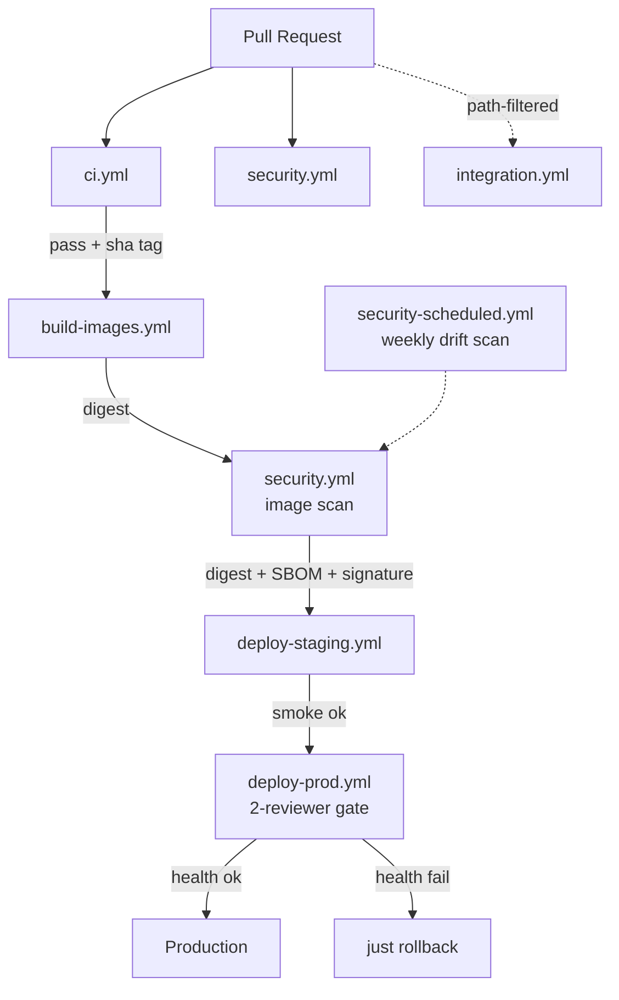

# Specification — GitHub Actions CI/CD Pipelines

Status: Proposed
Owner: Platform / DevOps
Applies to: the `Abugida-Backend` repository
Related: ADR-026 (devbox sandbox), ADR-027 (Bun 1.4 adoption), ADR-002 (digest-pinned base images), ADR-021 (just task runner), `docs/architecture/deployment-model.md`

---

## 1. Purpose

This document specifies the GitHub Actions pipelines for the Abugida monorepo: what workflows exist, what each job does, how they are gated, how artifacts flow between them, and what an operator must configure outside the repository (branch protection, environments, secrets, registry).

It is a **specification**, not an implementation. Every normative statement below uses RFC 2119 keywords (MUST / MUST NOT / SHOULD / MAY).

### 1.1 Goals

1. **Reproducible** — a CI run resolves the exact same toolchain (Bun 1.4.4, pnpm 12.15.0, linter versions) as the devbox sandbox and the container images.
2. **Fast** — a pull request reaches a merge decision in under 6 minutes of wall clock, warm cache.
3. **Least privilege** — every job runs with the minimum `GITHUB_TOKEN` scope it needs; no workflow runs on `pull_request_target`.
4. **Supply-chain auditable** — every published image is traceable to a commit SHA, carries an SBOM, is signed, and is scanned before it can be deployed.
5. **One deploy artifact** — the artifact that CI scanned is byte-identical to the artifact that production runs (digest pinning, never tag-based).
6. **Operator-parity** — the commands CI runs are the commands documented in `justfile` and `docs/development/testing.md`, not a parallel set invented for CI.

### 1.2 Non-goals

- Replacing Devbox as the local development environment.
- Kubernetes, Helm, or a managed CI platform. The target is single-host Docker Compose with SSH deployment (see `docs/architecture/deployment-model.md`).
- Building an in-house artifact registry. GHCR is sufficient.
- Test automation for the marketing site beyond what already exists (Astro has no unit tests today).

---

## 2. Repository facts that constrain the design

These are read from the repository at the time of writing and MUST be re-verified when the spec is implemented.

| Fact                   | Value                                                                                                                           | Consequence for CI                                                                                                                                 |
| ---------------------- | ------------------------------------------------------------------------------------------------------------------------------- | -------------------------------------------------------------------------------------------------------------------------------------------------- |
| Runtime                | Bun 1.4.4 (`.bun-version`, `engines`, `devEngines`)                                                                             | CI installs Bun from `.bun-version`, never a floating `latest`                                                                                     |
| Package manager        | pnpm 12.15.0 (`packageManager`)                                                                                                 | CI installs pnpm from `packageManager`; `bun install` MUST NOT run (no `bun.lock` exists; `bunfig.toml` sets `frozenLockfile = true` deliberately) |
| Task runner            | Turborepo 2.11 (`turbo.json`)                                                                                                   | `pnpm <script>` fans out via turbo; CI SHOULD use turbo's cache, not per-workspace loops                                                           |
| Workspaces             | `app/*` (api, dashboard, marketing), `packages/*` (auth, database, observability, queue, storage, tenant), `tooling/*`          | Path filters must cover `packages/**` and `tooling/**`, not just `app/**`                                                                          |
| Test runner            | `bun test` (not vitest/jest)                                                                                                    | Unit tests run under Bun; `bunfig.toml` preload comes from `@abugida/bun-test-config`                                                              |
| Native deps            | `allowBuilds` in `pnpm-workspace.yaml` (`esbuild`, `sharp`, `@google/genai`, `protobufjs`, `msgpackr-extract`, `unrs-resolver`) | Install MUST NOT use `--ignore-scripts`; build scripts are required                                                                                |
| `prepare` hook         | `husky && turbo run build --filter=./packages/*`                                                                                | Runs on every `pnpm install`; CI MUST set `HUSKY=0` and tolerate the extra package build                                                           |
| Container builds       | 3 Dockerfiles under `app/*/`, all built from the **repo root** context                                                          | Buildx MUST use `context: .` with `file: app/<name>/Dockerfile`                                                                                    |
| Base images            | `oven/bun:1.4.4-alpine` pinned by **tag + digest** (ADR-002)                                                                    | Trivy/renovate MUST NOT rewrite to digest-only or tag-only                                                                                         |
| Infrastructure         | 3 Compose tiers (dev / staging / prod) via `docker/compose/*.yml`                                                               | `just validate-compose` is a first-class CI gate, not a nicety                                                                                     |
| Secrets                | Vault in staging/prod, `.env` in dev (ADR-006)                                                                                  | CI never holds application runtime secrets for deployment; the host pulls them from Vault                                                          |
| Deployment             | `scripts/deploy/*.sh` + `just deploy-prod` + `just rollback` over SSH                                                           | Deploy workflows drive the existing scripts, not a parallel mechanism                                                                              |
| Integration tests      | `docker/tests/integration/test-suite.sh` requires a **running dev Compose stack**                                               | Integration gate needs Docker-in-Docker or a service stack; it is a separate, heavier job                                                          |
| Integration-test env   | `test-suite.sh` sources `.env` at the repo root                                                                                 | CI MUST materialise a `.env` before the suite runs                                                                                                 |
| Redis-gated unit tests | `packages/queue/tests/integration/*` hard-code `REDIS_AVAILABLE = false`                                                        | These are currently skipped by construction — see §16, Open Decision D-6                                                                           |
| Branch reality         | Repository has `master`; docs describe `main` + `dev`                                                                           | See Open Decision D-1 — this MUST be settled before workflows are written                                                                          |

---

## 3. Workflow inventory

Seven workflow files. Each has exactly one responsibility.

| #   | File                     | Trigger                                                                    | Purpose                                                              | Blocking?                     |
| --- | ------------------------ | -------------------------------------------------------------------------- | -------------------------------------------------------------------- | ----------------------------- |
| 1   | `ci.yml`                 | `pull_request`, `push` to default branch                                   | Fast feedback: lint, typecheck, unit test, build                     | **Yes** — required check      |
| 2   | `integration.yml`        | `pull_request` (path-filtered), `push` to default branch, `schedule`       | Compose-backed integration suite                                     | **Yes** for infra/app changes |
| 3   | `security.yml`           | `pull_request`, `push` to default branch, `workflow_dispatch`              | SAST, secret scan, dependency audit, dependency review, image scan   | **Yes**                       |
| 3b  | `security-scheduled.yml` | `schedule` (weekly), `workflow_dispatch`                                   | Drift scan: audit, image scan, Scorecard                             | No                            |
| 4   | `build-images.yml`       | `push` to default branch, tag `v*`, `workflow_dispatch`                    | Buildx multi-arch images → GHCR, SBOM, cosign signature              | No (gates deploy)             |
| 5   | `deploy-staging.yml`     | `workflow_dispatch`, `push` to `staging` branch, successful `build-images` | Deploy the exact digest to staging, health-check, smoke-test         | No                            |
| 6   | `deploy-prod.yml`        | `workflow_dispatch`, tag `v*`, `release` published                         | Deploy the exact digest to prod behind a 2-reviewer environment gate | No (but required for release) |

Supporting (non-workflow) files:

```
.github/
├── actions/
│   ├── setup-toolchain/     # composite: bun + pnpm + node + linters
│   └── setup-otel/          # composite: OTLP exporter env (future)
├── workflows/
│   ├── ci.yml
│   ├── integration.yml
│   ├── security.yml
│   ├── security-scheduled.yml
│   ├── build-images.yml
│   ├── deploy-staging.yml
│   └── deploy-prod.yml
├── CODEOWNERS
└── dependabot.yml           # exists — renovate is NOT adopted
```

**Deliberate non-adoption:** no `stale.yml`, no `labeler.yml`, no `release-drafter.yml`, no `semantic-release`, no `docker-publish` action. These add surface area without solving a problem this repository has.

### 3.1 Pipeline graph



---

## 4. Toolchain resolution and drift prevention

**Requirement (normative).** The toolchain used by CI MUST be derived from files already committed to the repository. CI MUST NOT hard-code version numbers that already exist elsewhere in the tree.

| Tool                                                                                           | Source of truth                   | How CI resolves it                                                             |
| ---------------------------------------------------------------------------------------------- | --------------------------------- | ------------------------------------------------------------------------------ |
| Bun                                                                                            | `.bun-version`                    | `oven-sh/setup-bun` with `bun-version-file: .bun-version`                      |
| pnpm                                                                                           | `package.json` → `packageManager` | `pnpm/action-setup` with `version` parsed from `packageManager`, or `corepack` |
| Linters (shellcheck, hadolint, yamllint, gitleaks, dotenv-linter, editorconfig-checker, shfmt) | `devbox.json` `packages[]`        | Composite action installs the **same versions** as `devbox.json`               |
| cspell, markdownlint, knip, syncpack, eslint, prettier, turbo                                  | workspace `package.json`          | Installed by `pnpm install --frozen-lockfile`                                  |

**Drift guard.** `ci.yml` MUST include a `toolchain-drift` job that:

1. Parses the pinned linter versions out of `devbox.json`.
2. Parses the pinned linter versions out of `.github/actions/setup-toolchain/action.yml`.
3. Fails if any pair differs.

This is the CI equivalent of `just sandbox-doctor` and is what keeps ADR-026 meaningful over time.

**Version pinning of Actions.** Every third-party action MUST be referenced by **full commit SHA**, with the human-readable version in a trailing comment. Dependabot's `github-actions` ecosystem (already configured) keeps the SHAs current.

```yaml
- uses: actions/checkout@08c6903cd8c0fde910a37f88322edcfb5dd907a8 # v5.0.1
```

Floating tags are a supply-chain risk and are prohibited.

---

## 5. `ci.yml` — the pull-request gate

### 5.1 Triggers

```yaml
on:
  pull_request:
    branches: ['**']
    types: [opened, synchronize, reopened]
  push:
    branches: ['master'] # subject to Open Decision D-1
  workflow_dispatch:
```

`pull_request` (not `pull_request_target`) is mandatory: `pull_request_target` runs with repository secrets and write scope against untrusted fork code.

### 5.2 Concurrency and permissions

```yaml
concurrency:
  group: ci-${{ github.workflow }}-${{ github.ref }}
  cancel-in-progress: ${{ github.event_name == 'pull_request' }}

permissions:
  contents: read
```

Superseded pull-request runs are cancelled. Push-to-default-branch runs are **not** cancelled (a half-finished run on `master` must complete so its artifacts stay valid).

### 5.3 Jobs

| Job               | Runs                                           | Depends on        | Timeout | Blocking       |
| ----------------- | ---------------------------------------------- | ----------------- | ------- | -------------- |
| `toolchain-drift` | `bash scripts/ci/check-toolchain-drift.sh`     | —                 | 5 min   | Yes            |
| `lint`            | `pnpm lint` + the history-free `lint:*` gates  | `toolchain-drift` | 10 min  | Yes            |
| `typecheck`       | `pnpm typecheck`                               | `toolchain-drift` | 10 min  | Yes            |
| `test`            | `pnpm test` (turbo fan-out, `bun test`)        | `toolchain-drift` | 15 min  | Yes            |
| `build`           | `pnpm build` (turbo)                           | `toolchain-drift` | 15 min  | Yes            |
| `format`          | `prettier --check` over the tree               | `toolchain-drift` | 5 min   | Yes            |
| `commitlint`      | commitlint on PR commit range                  | —                 | 5 min   | Yes (PRs only) |
| `summary`         | aggregates results into `$GITHUB_STEP_SUMMARY` | all               | 5 min   | No             |

### 5.4 The lint job is a fan-out, not a single command

`pnpm lint` is `turbo lint && pnpm lint:tooling` — it does **not** include the repository-level CLI linters. The CI lint job MUST run the full gate set explicitly, because these are the gates the repo already declares as blocking in `tooling/README.md`:

```
pnpm lint                    # eslint across every workspace + repo-root tooling config
pnpm lint:tooling            # eslint over root config files
pnpm lint:spelling           # cspell
pnpm lint:docker             # hadolint over every tracked Dockerfile
pnpm lint:yaml               # yamllint over every tracked yml/yaml
pnpm lint:markdown           # markdownlint
pnpm lint:editorconfig       # editorconfig-checker
pnpm lint:env                # dotenv-linter over the four .env.example files
pnpm lint:shell              # shellcheck
pnpm lint:deps               # syncpack (version consistency)
```

`pnpm lint:secrets` (gitleaks) is intentionally **not** in this list — it runs in `security.yml` (§7.2).

`pnpm knip` is advisory today and MUST run in a **non-blocking** job that reports to the summary, not as a gate.

`lint:secrets` uses `gitleaks git`, which needs the full clone history (`fetch-depth: 0`). Paying that cost on every job in the matrix is wasteful, so the secrets scan runs **once**, in the `security.yml` workflow (§7.2), where full history is already required for `pnpm audit` and CodeQL. The `lint` job in `ci.yml` therefore runs every gate **except** `lint:secrets`.

The `lint` job is therefore a fan-out over gates that do not need history, and `security.yml` owns the gates that do. Both must be required checks, so the union is enforced exactly once.

### 5.5 Test job specifics

- MUST run `pnpm test`, which fans out through turbo to `bun test` per workspace.
- MUST NOT pass `--pass-with-no-tests` at the root level — that flag is per-workspace (`app/api`, `app/dashboard`) and is already in those manifests.
- MUST upload any produced coverage as an artifact (`actions/upload-artifact`, retention 7 days) even though coverage thresholds are not enforced yet.
- MUST NOT require Postgres, Redis, MinIO, or Vault. Any test that needs them is an integration test and belongs in `integration.yml` (§6). The queue integration tests currently self-disable (§2, D-6) and MUST NOT be "enabled" in CI until D-6 is resolved.

### 5.6 Cache strategy

| Cache        | Key                                                        | Path                        | Notes                                                                    |
| ------------ | ---------------------------------------------------------- | --------------------------- | ------------------------------------------------------------------------ |
| pnpm store   | `pnpm-${{ runner.os }}-${{ hashFiles('pnpm-lock.yaml') }}` | `~/.local/share/pnpm/store` | `restore-keys` on `pnpm-${{ runner.os }}-`                               |
| Turbo local  | `turbo-${{ runner.os }}-${{ github.sha }}`                 | `.turbo`                    | fallback when remote cache is unavailable                                |
| Turbo remote | n/a                                                        | n/a                         | `TURBO_TOKEN` + `TURBO_TEAM` secrets; **preferred** when configured      |
| Bun          | —                                                          | —                           | Bun is a runtime here, not a dependency manager; no install cache needed |

**Remote cache.** When `TURBO_TOKEN`/`TURBO_TEAM` are configured, turbo remote caching MUST be enabled and MUST be treated as an optimisation only. A cache miss MUST never fail a job. The remote cache MUST NOT be shared across branches for `main`/`master` deploy-triggering builds in a way that lets an untrusted branch poison a trusted build — turbo's `remoteCache.sig` signature check handles this, and CI MUST NOT disable signature verification.

**Install determinism.** The install step MUST be:

```bash
pnpm install --frozen-lockfile
```

`--frozen-lockfile` is the gate that fails when `pnpm-lock.yaml` is out of sync with any manifest. `HUSKY=0` MUST be set in the environment to stop the `prepare` hook from installing hooks (harmless but noisy and slow).

### 5.7 Job summary

Every workflow MUST write a Markdown table to `$GITHUB_STEP_SUMMARY` listing job name, status, duration, and the relevant artifact links. This is the only "notification" surface that is guaranteed to be seen; e-mail and chat notifications are optional (see §10).

---

## 6. `integration.yml` — Compose-backed verification

### 6.1 Scope

`docker/tests/integration/test-suite.sh --group all` performs smoke → API → cache → DB checks against a running **dev** Compose tier. It is heavy (10+ services) and MUST be isolated from the PR fast-feedback path.

### 6.2 Triggers

```yaml
on:
  pull_request:
    paths:
      - 'docker/**'
      - 'app/**'
      - 'packages/**'
      - 'scripts/**'
      - 'justfile'
      - '.env.example'
  push:
    branches: ['master']
  schedule:
    - cron: '17 3 * * *' # nightly, off-peak UTC
```

The `schedule` entry exists so the suite is exercised even when no human touches the repo (catches upstream image drift, e.g. a new `postgres:17-alpine` behaviour change).

### 6.3 Requirements

- The job MUST run on a runner with **Docker Compose v2** and enough resources for the dev tier (recommend `ubuntu-latest` with 4 vCPU / 16 GB, or a self-hosted Linux runner with the same).
- The job MUST materialise `.env` from `.env.example` before running the suite (`test-suite.sh` does `source .env` unconditionally and will fail without it).
- The job MUST tear the stack down in an `if: always()` step (`docker compose ... down -v`) so the runner is not left with volumes.
- The job MUST NOT run concurrently with itself on the same runner — use a dedicated concurrency group.
- The suite MUST be invoked through `just test-suite all` (the documented entry point), not by invoking the shell script directly, so the command stays identical to local and to `docs/development/testing.md`.

### 6.4 Environment

The dev tier is used, never staging or prod. CI MUST NOT point the suite at a shared or remote environment — that would make the suite non-hermetic and could destroy data.

---

## 7. `security.yml` — the supply-chain gate

### 7.1 Triggers

`security.yml` (the PR/push path):

```yaml
on:
  pull_request:
  push:
    branches: ['master']
  workflow_dispatch:
```

`security-scheduled.yml` (the weekly drift path):

```yaml
on:
  schedule:
    - cron: '33 4 * * 1' # weekly, Monday 04:33 UTC
  workflow_dispatch:
```

The weekly scan is a **separate file** rather than a `schedule` trigger on the same file, for two reasons: a scheduled run must not be cancelled by a concurrent push on the same concurrency group, and the weekly run only needs the drift-sensitive jobs (`dependency-audit`, `image-scan`, `scorecard`) — not the whole gate set. Keeping them separate makes the "always-on" weekly posture obvious in the Actions UI and keeps the PR path fast.

### 7.2 Jobs

| Job                 | Tool                                      | Input                                          | Severity gate                    | Blocking         |
| ------------------- | ----------------------------------------- | ---------------------------------------------- | -------------------------------- | ---------------- |
| `secret-scan`       | gitleaks 8.30.1                           | full history (`fetch-depth: 0`) + working tree | any finding                      | Yes              |
| `dependency-audit`  | `pnpm audit` + Trivy `fs` on the lockfile | repo                                           | HIGH / CRITICAL                  | Yes              |
| `sast`              | CodeQL (`javascript-typescript`)          | repo                                           | per CodeQL rules                 | Yes              |
| `dependency-review` | `actions/dependency-review-action`        | PR diff only                                   | HIGH / CRITICAL in new deps      | Yes (PRs)        |
| `image-scan`        | Trivy 0.58+                               | built images by **digest**                     | HIGH / CRITICAL                  | Yes (post-build) |
| `scorecard`         | OpenSSF Scorecard                         | repo                                           | advisory                         | No               |
| `sbom`              | Syft                                      | images                                         | advisory (attestation published) | No               |

`image-scan` and `sbom` operate on **published** images, so they only run once `build-images.yml` has produced digests. They are triggered by a `workflow_run` completion of `build-images.yml`, not by `pull_request` — a pull request does not publish images. The `workflow_run` trigger grants access to the upstream run's artifacts by default and MUST have `permissions:` explicitly narrowed; it is the one trigger in this design that can leak write scope if misconfigured.

### 7.3 Gate semantics

Consistent with `docs/architecture/deployment-model.md` §Pipeline Guards:

- **Trivy HIGH > 0 → block.** CRITICAL > 0 → block.
- **gitleaks any finding → block.** `.gitleaks.toml` already carries a reviewed allowlist; adding an allowlist entry to silence CI is prohibited — it is a code change requiring review.
- **`pnpm audit` HIGH/CRITICAL → block.** The repository currently has zero advisories (ADR-027), so this gate must stay green; regressions are real regressions.
- **CodeQL** — `security-severity` alerts block on `error` and `warning`; `note` is advisory.
- **Dependency review** — only applies to pull requests; it inspects the _diff_, so it catches a new vulnerable dependency even when the base branch is already dirty.

### 7.4 Image scanning contract

`image-scan` MUST scan by **digest**, never by tag. The digest comes from the `build-images.yml` workflow output. This is the mechanism that guarantees "the artifact we scanned is the artifact we deploy".

`build-images.yml` MUST therefore expose its digest as a workflow output AND publish it as a small JSON artifact (`images.json`) that `security.yml` and the deploy workflows consume.

### 7.5 Scheduling rationale

The weekly schedule is what catches drift that a PR cannot: a newly disclosed CVE in `postgres:17-alpine`, a compromised upstream release, a newly published malicious pnpm version that has not yet been flagged by the registry.

---

## 8. `build-images.yml` — the artifact producer

### 8.1 Triggers

```yaml
on:
  push:
    branches: ['master']
    tags: ['v*']
  workflow_dispatch:
    inputs:
      image:
        type: choice
        options: [api, dashboard, marketing]
```

### 8.2 Matrix and caching

Three services → a matrix over `api`, `dashboard`, `marketing`. The matrix MUST use `fail-fast: false` so one broken image does not mask the state of the other two.

```yaml
strategy:
  fail-fast: false
  matrix:
    service: [api, dashboard, marketing]
```

Buildx cache MUST use `type=gha` with **per-service scope** so the API's builder cache never invalidates the dashboard's:

```yaml
cache-from: type=gha,scope=${{ matrix.service }}
cache-to: type=gha,mode=max,scope=${{ matrix.service }}
```

The Dockerfiles already optimise for this: workspace manifests are copied before source, and the pnpm store is a BuildKit cache mount.

### 8.3 Build contract

- Context MUST be the repository root (`.`), `file: app/${{ matrix.service }}/Dockerfile`. This matches `docker/compose/app.yml` and the Dockerfile comments.
- Build args MUST include `BUILD_VERSION` (the commit SHA or tag) and `ENVIRONMENT`.
- The build MUST be reproducible: `--provenance=true --sbom=true` so BuildKit emits provenance and SBOM attestations attached to the image index.
- Images MUST be pushed to **GHCR** (`ghcr.io/${{ github.repository_owner }}/abugida-<service>`) using `GITHUB_TOKEN` with `packages: write`. No long-lived registry credentials.
- On a tag build, the image MUST additionally receive the semver tag and `latest`.

### 8.4 Tagging and digest contract

| Ref                  | Tag                                      |
| -------------------- | ---------------------------------------- |
| Every build          | `sha-<full-40-char-sha>`                 |
| Default-branch build | `sha-<sha>`, `main`/`master`             |
| Tag build `v1.2.3`   | `sha-<sha>`, `v1.2.3`, `1.2.3`, `latest` |

**Digest pinning is mandatory downstream.** The deploy workflows MUST pull `image@sha256:<digest>`. A tag-based deploy is prohibited because a mutable tag can be repointed between the scan and the deploy.

### 8.5 Signing

- `cosign sign --yes <digest>` using **keyless OIDC** (`id-token: write`).
- The signature is recorded in the GHCR attestation store.
- `cosign verify` MUST be executed by the deploy workflow before it pulls, proving the image was signed by this repository's workflow and has not been tampered with since.

### 8.6 Outputs

```yaml
outputs:
  digest: ${{ steps.meta.outputs.digest }}
  images: ${{ steps.collect.outputs.images }}
```

A `images.json` artifact is uploaded with `retention-days: 90` so a release can be reconstructed months later.

---

## 9. Deployment workflows

### 9.1 Shared principles

Both deploy workflows:

- MUST NOT rebuild anything. They consume a digest produced by `build-images.yml` and verified by `security.yml`.
- MUST run inside a **GitHub Environment** (`staging`, `production`). Environment secrets and protection rules are the only place deploy credentials live.
- MUST use SSH with a **host key pinned** in a repository secret (`known_hosts`), and MUST fail on an unknown host key. `StrictHostKeyChecking=yes` is non-negotiable.
- MUST deploy via the existing scripts (`just deploy-prod <version>`, `scripts/deploy/deploy.sh`) so that blue-green, canary, pre-flight, and rollback semantics stay in one place.
- MUST capture logs as artifacts, including on failure.
- MUST be idempotent and MUST NOT run concurrently with themselves (concurrency group per environment, `cancel-in-progress: false`).

### 9.2 `deploy-staging.yml`

| Property     | Value                                                                                                               |
| ------------ | ------------------------------------------------------------------------------------------------------------------- |
| Trigger      | `workflow_dispatch` (with a `digest` input), successful `build-images.yml` on the default branch, push to `staging` |
| Environment  | `staging`                                                                                                           |
| Approval     | None (fast iteration, per `docs/development/dev-workflow.md`)                                                       |
| Strategy     | `DEPLOY_STRATEGY=recreate`                                                                                          |
| Verification | `just health`, then the `smoke` + `api` groups of the integration suite against the staging host                    |
| Failure      | Job fails; no automatic rollback (staging is disposable)                                                            |

### 9.3 `deploy-prod.yml`

| Property     | Value                                                                                                                                                               |
| ------------ | ------------------------------------------------------------------------------------------------------------------------------------------------------------------- |
| Trigger      | `workflow_dispatch` (digest + strategy), `release.published` for a `v*` tag, or the `production` environment approval                                               |
| Environment  | `production` — **2 required reviewers**, deployment branch/tag restricted to `master` / `v*`                                                                        |
| Strategy     | `blue-green` by default; `canary` available via input                                                                                                               |
| Verification | `just health` (60 s timeout), `just deployment-status`, then `just health-replication`                                                                              |
| Failure      | **Automatic rollback** — `just rollback` in an `if: failure()` step, then page the on-call via the existing Telegram notifier (`scripts/backup/telegram-notify.sh`) |

The 2-reviewer gate is enforced by GitHub Environment protection rules, **not** by workflow logic. Workflow-level "approval" emulations can be bypassed and MUST NOT be used as the control.

### 9.4 Deploy-time secret handling

The deploy host holds the Vault token and the environment `.env`. CI holds only:

- `STAGING_SSH_KEY` / `PROD_SSH_KEY` (private keys, environment-scoped)
- `STAGING_KNOWN_HOSTS` / `PROD_KNOWN_HOSTS`
- `PROD_SSH_USER` / `STAGING_SSH_USER` / host names

Application secrets (database passwords, API keys) MUST NOT be sent from CI to the host. The host pulls them from Vault at startup (`app/*/entrypoint.sh`, ADR-006). This keeps the CI secret surface minimal and avoids CI becoming a second place where production credentials live.

### 9.5 Migration ordering

`scripts/deploy/migrate.sh` exists. The prod deploy MUST run migrations **before** the blue/green cutover and MUST be idempotent. If a migration fails, the deploy aborts **before** any traffic is shifted — the previous (blue) stack keeps serving. This ordering MUST be explicit in the workflow, not implied.

---

## 10. Notifications, reporting, and observability

| Channel            | Mechanism                                                                             | Required?                         |
| ------------------ | ------------------------------------------------------------------------------------- | --------------------------------- |
| PR checks          | GitHub check runs                                                                     | Yes — this is the primary surface |
| Job summary        | `$GITHUB_STEP_SUMMARY`                                                                | Yes — every workflow              |
| Failure annotation | `::error` / `::warning` on the relevant file:line                                     | Yes — lint and audit jobs         |
| Chat notification  | Telegram notifier (`scripts/backup/telegram-notify.sh`) for prod deploy/rollback only | Yes for prod; optional elsewhere  |
| CI metrics         | Run duration published as workflow artifacts / GitHub API usage                       | Optional (see §13)                |

Nightly/scheduled runs MUST NOT send chat notifications on success — only the prod deploy path and any blocking failure on the default branch notify.

---

## 11. Branch protection and required checks

The following MUST be configured in GitHub branch protection for the default branch (and for `staging` if it exists):

| Setting                         | Value                                                                                                                                                                                                                                            |
| ------------------------------- | ------------------------------------------------------------------------------------------------------------------------------------------------------------------------------------------------------------------------------------------------ |
| Required status checks          | `ci / lint`, `ci / typecheck`, `ci / test`, `ci / build`, `ci / format`, `ci / toolchain-drift`, `security / secret-scan`, `security / dependency-audit`, `security / sast`, `integration / integration` (the always-reporting gate — see below) |
| Require branches up to date     | Yes                                                                                                                                                                                                                                              |
| Require signed commits          | Yes                                                                                                                                                                                                                                              |
| Require linear history          | Yes (squash-merge only, per `docs/development/dev-workflow.md`)                                                                                                                                                                                  |
| Require reviews                 | 1 for staging, 2 for production releases                                                                                                                                                                                                         |
| Block force-pushes              | Yes                                                                                                                                                                                                                                              |
| Block branch deletion           | Yes                                                                                                                                                                                                                                              |
| Require conversation resolution | Yes                                                                                                                                                                                                                                              |
| Restrict who can push           | Yes — no direct pushes, even by admins                                                                                                                                                                                                           |
| Restrict who can merge          | Yes                                                                                                                                                                                                                                              |
| Allow bypass                    | **No** — not even for admins. The `just`/husky hooks are the fast local gate; CI is the enforcement point.                                                                                                                                       |

**Path-filtered checks are a known trap.** If `integration.yml` is skipped by its path filter, GitHub treats a skipped required check as _pending_ and blocks the merge indefinitely. Two acceptable resolutions:

1. **(Recommended)** Keep `integration.yml` unconditionally required, and let the workflow itself decide in under 30 seconds that the change is irrelevant (a fast no-op job with the same name). The required check always reports.
2. Use a separate always-running `integration-gate` job that evaluates the filter and passes immediately when the suite is not applicable.

Option 1 is preferred: it keeps the required-check list stable and the diff auditable.

---

## 12. Runner strategy

| Workflow           | Runner                                                                    | Rationale                                                                                                                               |
| ------------------ | ------------------------------------------------------------------------- | --------------------------------------------------------------------------------------------------------------------------------------- |
| `ci.yml`           | GitHub-hosted `ubuntu-latest` (4 vCPU)                                    | Fast to schedule, no cold-start cost; the job is I/O-light thanks to turbo caching                                                      |
| `integration.yml`  | GitHub-hosted `ubuntu-latest` **or** a dedicated self-hosted Linux runner | The dev Compose tier is heavy. Self-hosted is cheaper and avoids per-minute billing spikes, but MUST be ephemeral or reset between jobs |
| `security.yml`     | GitHub-hosted                                                             | Trivy/CodeQL need predictable disk and CPU                                                                                              |
| `build-images.yml` | GitHub-hosted with Buildx + QEMU                                          | Multi-arch builds need the standard toolkit; `docker/setup-qemu-action` is required for `linux/arm64`                                   |
| `deploy-*`         | GitHub-hosted                                                             | Deploy jobs are short and secret-sensitive; hosted runners are ephemeral by default                                                     |

**Multi-arch.** `build-images.yml` SHOULD build `linux/amd64` and `linux/arm64`. If the production hosts are amd64 only, build amd64 as a fast lane and arm64 as a non-blocking lane, so an arm64 build failure does not block an amd64 release.

**Self-hosted runner hardening (if introduced).** ephemeral runners only, non-root, no Docker socket exposed to untrusted PR code, and PRs from forks MUST run on hosted runners.

---

## 13. Cost and performance budget

| Metric                           | Target  | Enforcement                               |
| -------------------------------- | ------- | ----------------------------------------- |
| PR → merge decision (warm cache) | ≤ 6 min | Alert if p50 > 6 min over a 14-day window |
| `ci.yml` runner-minutes per PR   | ≤ 12    | Track via the Actions usage API           |
| Cache hit rate (pnpm + turbo)    | ≥ 85 %  | Track                                     |
| Total CI minutes/month           | ≤ 3,000 | Budget alert at 80 %                      |

Cost levers, in order of impact:

1. Turbo remote caching (`TURBO_TOKEN`) — the single biggest lever; it collapses `typecheck` from ~66 s to ~5 s per ADR-027.
2. pnpm store caching keyed on `pnpm-lock.yaml`.
3. Splitting `lint`/`typecheck`/`test`/`build` into parallel jobs (wall-clock win) rather than one sequential job.
4. Path filters on `integration.yml` and `security.yml`.
5. Skipping `build` on docs-only changes (via `paths-ignore` on the whole workflow for `docs/**`, `**/*.md`).

Do **not** optimise by removing gates. The gate set is the deliverable; the runtime is a constraint.

---

## 14. Relationship to existing tooling

| Existing mechanism         | CI relationship                                                                                                                                                                                                              |
| -------------------------- | ---------------------------------------------------------------------------------------------------------------------------------------------------------------------------------------------------------------------------- |
| `just` recipes             | CI MUST invoke `just` recipes where a recipe exists (`just test-suite`, `just validate-compose`, `just deploy-prod`, `just rollback`, `just health`) so that the CI command and the documented operator command cannot drift |
| `devbox` (ADR-026)         | The sandbox remains the **local** environment. CI installs the same pinned versions directly (Devbox in CI adds Nix bootstrap cost for no benefit). `toolchain-drift` enforces the equivalence                               |
| `husky` hooks              | Local fast gate only. Never a substitute for CI                                                                                                                                                                              |
| `commitlint` (root config) | Enforced in CI via `commitlint` on the PR commit range, so a bad message cannot enter `master` even if hooks are skipped with `--no-verify`                                                                                  |
| `lint-staged`              | Local only                                                                                                                                                                                                                   |
| `dependabot.yml`           | Configured for pnpm-lock / docker / github-actions. Dependabot PRs are validated by this same CI pipeline                                                                                                                    |
| `turbo.json`               | Source of the task graph CI drives                                                                                                                                                                                           |

---

## 15. Failure semantics

| Failure                            | Behaviour                                                                                                                   |
| ---------------------------------- | --------------------------------------------------------------------------------------------------------------------------- |
| Any `ci.yml` job fails             | PR is blocked; push to `master` marks the commit as not deployable                                                          |
| `security.yml` finds HIGH/CRITICAL | Merge blocked; a push to `master` does **not** trigger an image build for the affected service                              |
| `integration.yml` fails            | Merge blocked; if the failure is on `master`, the default-branch build is marked red and the deploy workflow refuses to run |
| `build-images.yml` fails           | No digest is produced; deploy workflows have nothing to consume and MUST fail closed                                        |
| Prod deploy fails health checks    | Automatic `just rollback`; Telegram page to on-call; `production` environment flagged                                       |
| Secrets leak detected              | Block, then treat as a security incident: rotate the credential, purge the commit history, then re-run                      |

**Fail-closed is the default.** Every deploy workflow MUST verify that the digest it was given is present in the `images.json` artifact and that the image passes `cosign verify` before it touches the target host.

---

## 16. Open decisions

These must be resolved before implementation. Each is listed with the recommended option.

| ID       | Question                                                                                                                     | Recommendation                                                                                                                                                                                                                   |
| -------- | ---------------------------------------------------------------------------------------------------------------------------- | -------------------------------------------------------------------------------------------------------------------------------------------------------------------------------------------------------------------------------- |
| **D-1**  | The repo has `master`; `docs/development/dev-workflow.md` describes `main` + `dev`. Which is canonical?                      | Rename to `main` and add `develop`, or amend the docs to match `master`. **Pick one and update the docs in the same PR.** The workflows must not be written against a branch that does not exist                                 |
| **D-2**  | Which registry?                                                                                                              | GHCR. It is free, supports OIDC keyless signing, and needs no extra infrastructure                                                                                                                                               |
| **D-3**  | Is remote turbo cache acceptable?                                                                                            | Yes — configure `TURBO_TOKEN`/`TURBO_TEAM`. If declined, fall back to `actions/cache` on `.turbo` and accept a slower cold path                                                                                                  |
| **D-4**  | Are production hosts amd64-only?                                                                                             | If yes, arm64 becomes a non-blocking lane; if no, both are blocking                                                                                                                                                              |
| **D-5**  | Where does the deployment SSH target live — a single host, or one per environment?                                           | One host per environment. `staging` and `production` MUST NOT share a host                                                                                                                                                       |
| **D-6**  | `packages/queue/tests/integration/*` hard-codes `REDIS_AVAILABLE = false`, so Redis integration coverage is effectively zero | Replace the constant with `process.env.REDIS_AVAILABLE === 'true'` and run that suite in `integration.yml` against the Compose Redis. **A CI service that is structurally disabled is worse than no service — it hides the gap** |
| **D-7**  | Should `knip` become blocking?                                                                                               | Advisory for now; revisit once the unused-export count reaches zero                                                                                                                                                              |
| **D-8**  | Where does `cspell` fit — CI or pre-commit?                                                                                  | CI. It is currently only in the root script set and is not enforced anywhere                                                                                                                                                     |
| **D-9**  | Should `docs/**`-only changes skip `ci.yml` entirely?                                                                        | No. Skip only `build`; keep `lint` (markdownlint + cspell) because docs are linted by the same gates                                                                                                                             |
| **D-10** | Self-hosted runners for integration?                                                                                         | Start on GitHub-hosted; migrate to self-hosted only if the measured cost justifies the operational overhead                                                                                                                      |

---

## 17. Implementation roadmap

Each phase is independently shippable and leaves the repository in a green state.

Phase 1 — Fast feedback (day 1–2)

1. `.github/actions/setup-toolchain/action.yml` (Bun + pnpm + linters).
2. `scripts/ci/check-toolchain-drift.sh`.
3. `ci.yml` with `toolchain-drift`, `lint`, `typecheck`, `test`, `build`, `format`, `commitlint`, `summary`.
4. Branch protection with the `ci.yml` checks required.
5. `.github/CODEOWNERS`.

Phase 2 — Supply chain (day 3–4)

1. `security.yml`: secret-scan, dependency-audit, SAST, dependency-review.
2. `security-scheduled.yml`: weekly drift scan (audit, image scan, Scorecard).
3. Branch protection extended with the `security.yml` checks.

Phase 3 — Artifacts (day 5–6)

1. `build-images.yml`: matrix, Buildx + `type=gha` cache, GHCR push, provenance/SBOM attestations, cosign keyless signing, `images.json` output.
2. `image-scan` job in `security.yml`, consuming digests.

Phase 4 — Integration (day 7)

1. `integration.yml` with the Compose dev tier, `.env` materialisation, guaranteed teardown.
2. Resolve **D-6** so Redis integration tests actually run.
3. Required-check wiring per §11 (including the always-reporting gate).

Phase 5 — Deployment (day 8–10)

1. `staging` and `production` GitHub Environments with protection rules.
2. `deploy-staging.yml`, `deploy-prod.yml` with digest pinning, cosign verification, health gates, automatic rollback.
3. SSH key + known-hosts provisioning, key rotation procedure documented in `docs/runbooks/deploy/`.

Phase 6 — Hardening (ongoing)

1. Scheduled runs, cost dashboards, alerting on CI duration, `workflow_dispatch` runbook, periodic secret rotation.

---

## 18. Acceptance criteria

The CI/CD work is complete when all of the following hold:

- [ ] A push to the default branch produces a green run of `ci.yml`, `security.yml`, and `build-images.yml` with no manual intervention.
- [ ] `pnpm install --frozen-lockfile` in CI produces byte-identical dependency resolution to a local `pnpm install --frozen-lockfile`.
- [ ] The Bun and pnpm versions used in CI are provably identical to `.bun-version` and `packageManager`.
- [ ] Every linter version in CI matches `devbox.json`, enforced by a failing test if they diverge.
- [ ] A `gitleaks` finding in a pull request blocks the merge.
- [ ] A Trivy HIGH/CRITICAL in a newly added dependency blocks the merge.
- [ ] A published image carries provenance, an SBOM, and a valid cosign signature.
- [ ] `cosign verify` passes for the exact digest a production deploy consumes.
- [ ] A production deploy cannot start without two environment approvals.
- [ ] A failed production health check results in an automatic `just rollback` and a Telegram notification.
- [ ] A pull request from a fork runs with no access to repository secrets and with a read-only token.
- [ ] No third-party action is referenced by a floating tag.
- [ ] The `integration` required check always reports a status (never stays pending).
- [ ] Median PR-to-merge-decision time is ≤ 6 minutes with a warm cache.

---

## 19. References

- `docs/architecture/deployment-model.md` — pipeline architecture and pipeline guards
- `docs/development/dev-workflow.md` — branching model and PR process
- `docs/development/testing.md` — test categories and their runners
- `docs/adr/ADR-026-devbox-sandbox.md` — pinned toolchain
- `docs/adr/ADR-027-bun-1-4-adoption.md` — CI pipeline adoption, `bun check`
- `docs/adr/ADR-002-alpine-base-images.md` — digest pinning
- `docs/adr/ADR-021-just-recipes.md` — `just` as the operator interface
- `tooling/README.md` — the blocking-gate matrix CI MUST implement
- GitHub Docs: [Secure use reference](https://docs.github.com/en/actions/security-for-github-actions/security-guides/security-hardening-for-github-actions), [Environments](https://docs.github.com/en/actions/deployment/targeting-different-environments/managing-environments-for-deployment), [OIDC](https://docs.github.com/en/actions/deployment/security-hardening-your-deployments/about-security-hardening-with-openid-connect)
