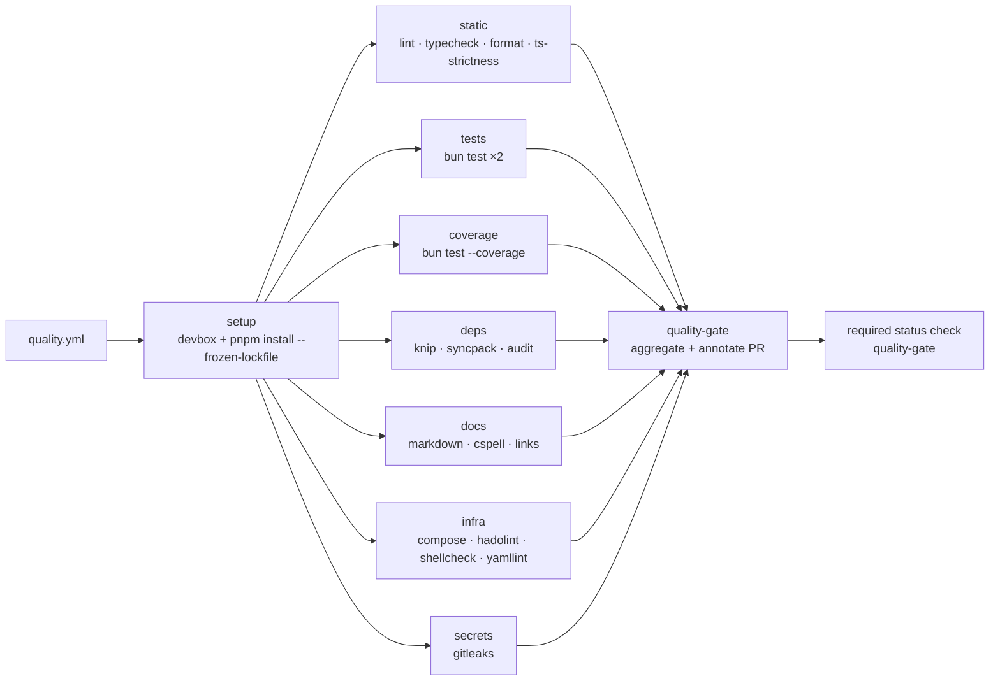
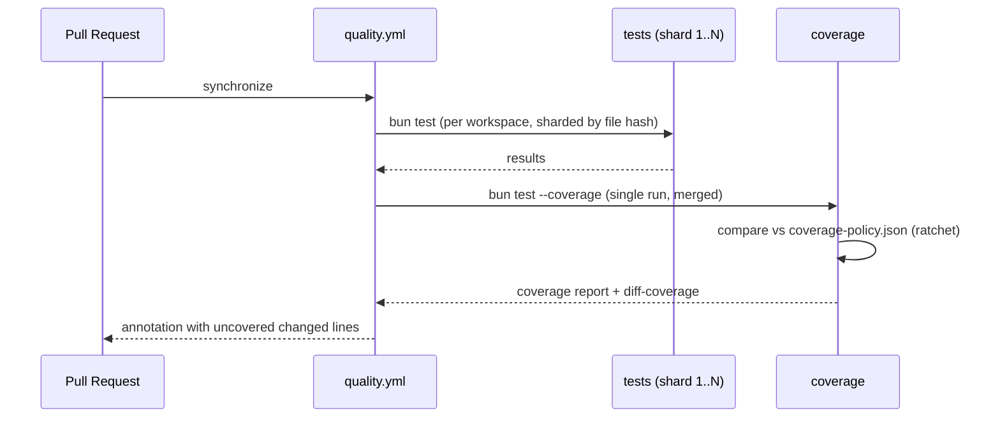

# Quality Gate Specification — Abugida Backend

| Field          | Value                                                                                   |
| -------------- | --------------------------------------------------------------------------------------- |
| Document ID    | `QGS-001`                                                                               |
| Version        | 1.0.0                                                                                   |
| Status         | Proposed                                                                                |
| Scope          | Entire monorepo (`app/*`, `packages/*`, `tooling/*`, `scripts/*`, `docker/*`, `docs/*`) |
| Applies to     | Every pull request, every merge, every release                                          |
| Owner          | Repository maintainers (see §12 RACI)                                                   |
| Review cadence | Quarterly, or on any change to the toolchain / CI topology                              |
| Related        | `AGENTS.md`, `CONTRIBUTING.md`, `SECURITY.md`, `docs/development/testing.md`, ADR-026   |

---

## 1. Purpose

This document defines **what must be true before code is allowed to move from one stage of the delivery pipeline to the next** in the Abugida monorepo. It is the normative source for:

1. The **gate tiers** (fast local → PR → merge → staging → production).
2. The **gate catalogue** — every individual check, its exact command, its scope, its blocking policy, and its thresholds.
3. The **merge criteria** (Definition of Done) for a pull request.
4. The **CI topology** — the workflows, jobs, matrices, caching and concurrency rules that execute the gates.
5. The **exception process** (waivers, with expiry and ownership).
6. The **quality metrics** used to judge whether the gate system itself is working.

**Non-goals.** This specification does not replace the existing tooling guides (`tooling/README.md`), the ADR process, or the operational runbooks. It _binds_ them into an enforceable pipeline.

**Normative language.** `MUST` / `MUST NOT` are blocking requirements. `SHOULD` are strong recommendations that may be waived. `MAY` are optional.

---

## 2. Repository Baseline (audit of 2025-10-22)

The specification is derived from a deep audit of the repository as it stands. The baseline below is factual and is the reference point for §14 (rollout).

### 2.1 Structure

| Layer           | Path                     | Package                  | Role                                               |
| --------------- | ------------------------ | ------------------------ | -------------------------------------------------- |
| Apps            | `app/api`                | `@abugida/api`           | Hono REST API (`:3001`), OpenAPI                   |
|                 | `app/dashboard`          | `@abugida/dashboard`     | TanStack Start dashboard (`:3000`)                 |
|                 | `app/marketing`          | `@abugida/marketing`     | Astro landing page (`:4321`)                       |
| Shared packages | `packages/auth`          | `@abugida/auth`          | Better Auth instance + plugin registry             |
|                 | `packages/database`      | `@abugida/database`      | Drizzle schema (7 domains) + client                |
|                 | `packages/observability` | `@abugida/observability` | Pino + OpenTelemetry                               |
|                 | `packages/queue`         | `@abugida/queue`         | BullMQ / Redis Sentinel                            |
|                 | `packages/storage`       | `@abugida/storage`       | S3-compatible object storage                       |
|                 | `packages/tenant`        | `@abugida/tenant`        | Tenancy resolution + authorization                 |
| Tooling layer   | `tooling/*`              | `@abugida/*-config`      | ESLint / Prettier / TS / CSpell / Bun test presets |
| Infrastructure  | `docker/`                | —                        | Modular Compose (7 files) + 3 profiles             |
| Operations      | `scripts/`               | —                        | backup / deploy / restore / security / monitoring  |

**Scale:** ~1,600 TypeScript sources; 227 test files; ~2,400 assertions in the dashboard alone; 26 ADRs; 60+ operational scripts.

### 2.2 Toolchain (pinned via Devbox, ADR-026)

- Runtime: **Bun ≥ 1.4.2** (`.bun-version`), package manager: **pnpm 12.8.1** (`packageManager` field).
- `pnpm-workspace.yaml` sets `allowBuilds` for native deps and `patchedDependencies` for `@tanstack/react-router`.
- `bunfig.toml` sets `frozenLockfile = true` — bun must never mutate the dependency graph.
- Turbo (`turbo.json`) drives `dev`, `build`, `lint`, `format`, `typecheck`, `test`, `db:*`, `generate-routes`.

### 2.3 Existing quality assets (assets to be gated, not rebuilt)

| Asset                                                                                                                        | Present | Notes                                                      |
| ---------------------------------------------------------------------------------------------------------------------------- | ------- | ---------------------------------------------------------- |
| Strict TypeScript presets (`noUncheckedIndexedAccess`, `exactOptionalPropertyTypes`, `noImplicitReturns`, `isolatedModules`) | ✅      | `tooling/typescript-config/{base,node,library}.json`       |
| Shared ESLint policy (typescript-eslint 8.69.0)                                                                              | ✅      | Framework plugins owned per workspace                      |
| Shared Prettier policy                                                                                                       | ✅      | no semicolons, single quotes, `printWidth` 100             |
| ESLint + Prettier via lint-staged (husky `pre-commit`)                                                                       | ✅      | Workspace-aware file routing, auto-discovered              |
| `pnpm typecheck` (husky `pre-push`)                                                                                          | ✅      | Turbo fan-out                                              |
| Commitlint / Conventional Commits (husky `commit-msg`)                                                                       | ✅      |                                                            |
| `bun test` runner, shared preload + matchers                                                                                 | ✅      | `tooling/bun-test-config`                                  |
| Repo linters: spell / docker / yaml / markdown / editorconfig / env / secrets / shell / deps                                 | ✅      | Root-level single-file configs                             |
| Knip (unused files/exports/deps) — advisory                                                                                  | ✅      | `knip.config.js`                                           |
| Syncpack (dependency version consistency)                                                                                    | ✅      | `syncpack.config.js`                                       |
| Trivy dependency & image audit script                                                                                        | ✅      | `scripts/security/audit-dependencies.sh`                   |
| Config security scanner                                                                                                      | ✅      | `scripts/security/check-configs.sh`                        |
| Compose validation                                                                                                           | ✅      | `just validate-compose`                                    |
| Integration test suite (smoke/api/cache/db)                                                                                  | ✅      | `docker/tests/integration/test-suite.sh`                   |
| OWASP ZAP scan policy                                                                                                        | ⚠️      | Policy file only — no runner                               |
| k6 performance scenarios                                                                                                     | ⚠️      | Directory exists (`.gitkeep` only) — no scenarios          |
| **CI pipelines**                                                                                                             | ❌      | **No `.github/workflows/` at all**                         |
| **Dependency update automation**                                                                                             | ❌      | No Renovate / Dependabot                                   |
| **CODEOWNERS**                                                                                                               | ❌      | No ownership enforcement                                   |
| **Release / publish workflow**                                                                                               | ❌      | 5 packages are `private: false` and publishable            |
| **Code coverage measurement / thresholds**                                                                                   | ❌      | `bun test --coverage` exists in 2 packages, never enforced |

### 2.4 Verified baseline results (commands executed against the working tree)

| Command                                                         | Result                  | Detail                                                                                                                                                        |
| --------------------------------------------------------------- | ----------------------- | ------------------------------------------------------------------------------------------------------------------------------------------------------------- |
| `pnpm typecheck`                                                | ✅ PASS                 | 9/9 workspaces, ~78 s                                                                                                                                         |
| `pnpm test`                                                     | ✅ PASS                 | 8 workspaces, dashboard 2390 pass / 0 fail / 153 files                                                                                                        |
| `pnpm lint`                                                     | ❌ FAIL                 | `app/dashboard` — 2 × `import/newline-after-import` in `tests/courses/courses.markdown-draft-mirror.test.ts` and `courses.markdown-offline-queue.test.ts`     |
| `pnpm lint:deps` (syncpack)                                     | ✅ PASS                 | no issues                                                                                                                                                     |
| `pnpm knip`                                                     | ❌ FAIL                 | unused root devDependency `prettier-plugin-astro`                                                                                                             |
| `pnpm lint:spelling`                                            | ❌ FAIL                 | `devbox` / `Devbox` not in the CSpell dictionaries                                                                                                            |
| `pnpm lint:docker/yaml/shell/env/secrets/markdown/editorconfig` | ⚠️ NOT RUNNABLE locally | binaries (`hadolint`, `markdownlint`, `gitleaks`, `dotenv-linter`, `editorconfig-checker`) are not on the host PATH — they are provided by the Devbox sandbox |
| `just validate-compose`                                         | ⚠️ NOT RUN              | requires Docker daemon                                                                                                                                        |

### 2.5 Material gaps identified

**G-01 — No CI.** The repository documents three workflows (`deploy-staging.yml`, `deploy-prod.yml`, `security.yml` in `docs/development/dev-workflow.md`) and `docs/configuration/adding-a-service.md` instructs contributors to update `.github/workflows/`. **None of these files exist.** Every gate today runs only on a developer machine; nothing is enforced on the PR.

**G-02 — Gate failure is a local-only concept.** Because there is no CI, a PR can be merged with failing lint, failing knip, failing spelling, no tests for new code, and no evidence the branch still builds. The husky hooks are skipped with `--no-verify` and do not cover the 6 of 9 `pnpm lint:*` scripts that depend on system binaries.

**G-03 — No coverage floor.** No coverage report is produced, uploaded, or compared against a threshold. 227 test files exist but there is no measure of what they cover.

**G-04 — Test depth is uneven.** `app/dashboard` is well covered (153 files, incl. structural guard tests such as the rules-of-hooks guard). `app/api` has 15 test files, all of them config/middleware/OpenAPI-shape — **no route, handler, service or repository behaviour test**. `app/marketing` has **no test script and no tests at all**.

**G-05 — Architectural rules are prose-only.** The two hard boundaries of this codebase — _no cross-app imports_ and _sibling `@abugida/*` packages must be peer dependencies_ — are stated in `AGENTS.md` and `CONTRIBUTING.md` but **not machine-enforced**. A regression is caught only in code review.

**G-06 — Environment contract drift is not enforced.** `packages/auth/env` and `packages/tenant/env` own Zod shapes; each app owns `.env.example`. There is no check that the three `.env.example` files, the Zod schemas, and the runtime reads agree.

**G-07 — Schema drift is not enforced.** `drizzle-kit generate` must accompany a schema change (same-commit rule in `CONTRIBUTING.md`), but nothing verifies that a PR touching `packages/database/src/schema/**` also contains a migration, nor that migrations apply cleanly to a fresh database.

**G-08 — Dependency hygiene is advisory.** Knip and syncpack are declared "advisory" in `AGENTS.md`; both currently fail. There is no `pnpm audit`/Trivy gate on the JS dependency graph, no licence policy, and no SBOM.

**G-09 — Documentation drift.** `docs/development/testing.md` references `bun.lockb` (the repo is pnpm-only since ADR-001), states k6 has "no `just` recipe" while `just test-suite` exists, and states service counts (dev 5 / staging 11 / prod 25) that disagree with `docs/onboarding/project-structure.md` (dev 6 / staging 20 / prod 31) and with `just validate-compose` (dev 6 / staging 10 / prod 24). Two different counts appear for the same tiers in two documents.

**G-10 — Local tooling is not hermetic.** The 6 CLI linters that the blocking scripts depend on are absent from the host PATH; only the Devbox sandbox provides them. A developer on the host runs `pnpm lint` and believes the repository is clean when 7 of 13 lint gates never executed.

**G-11 — Release path is undefined.** `packages/{auth,database,observability,queue,storage,tenant}` are `private: false` with `publishConfig.access = public`, but there is no version bump strategy, changelog, release workflow, or provenance attestation.

**G-12 — Branch protection is declarative only.** `dev-workflow.md` describes review counts and environment protection rules that exist only in prose; no `CODEOWNERS`, no enforced required checks.

---

## 3. Gate model

### 3.1 Tiers

```mermaid
flowchart TD
  A[Developer machine<br/>G0 — pre-commit] --> B[Push / PR opened<br/>G1 — pull_request]
  B --> C{All G1 gates<br/>green?}
  C -- no --> B
  C -- yes --> D[Merge to dev<br/>G2 — branch protection]
  D --> E[Staging deploy<br/>G3 — post-deploy]
  E --> F{Promotion to main<br/>G4 — release]
  F -- yes --> G[Production deploy<br/>G5 — post-deploy]

  style A fill:#e8f0fe,stroke:#4285f4
  style B fill:#e6f4ea,stroke:#34a853
  style D fill:#fef7e0,stroke:#fbbc04
  style F fill:#fce8e6,stroke:#ea4335
```

| Tier | Name               | Trigger                            | Latency budget | Blocking | Owner             |
| ---- | ------------------ | ---------------------------------- | -------------- | -------- | ----------------- |
| G0   | Local fast         | `git commit` (husky `pre-commit`)  | < 20 s         | Yes      | Developer         |
| G1   | PR validation      | Every push to a PR, every PR event | < 12 min       | Yes      | CI                |
| G2   | Merge control      | Branch protection on `dev`         | — (rule set)   | Yes      | Branch protection |
| G3   | Staging validation | Deploy to staging                  | < 20 min       | Yes      | CI                |
| G4   | Release readiness  | PR to `main`                       | < 20 min       | Yes      | CI                |
| G5   | Production gate    | Deploy to production               | < 30 min       | Yes      | CI + humans       |

### 3.2 Blocking policy vocabulary

| Policy      | Meaning                                                                                                                         |
| ----------- | ------------------------------------------------------------------------------------------------------------------------------- |
| `BLOCKING`  | Failure fails the job; the job fails the workflow; the check must be in branch protection's _required_ list.                    |
| `ADVISORY`  | Failure annotates the PR with a warning and uploads a report; it never fails the job. May be promoted to `BLOCKING` via an ADR. |
| `SCHEDULED` | Runs on a cron schedule, not per-PR. Failure pages the owning team.                                                             |

Every gate in §5 carries an explicit policy. Any change of policy for a `BLOCKING` gate requires an ADR (the gate system is part of the delivery architecture).

---

## 4. Definition of Done (merge criteria)

A pull request **MUST NOT** be merged unless **all** of the following hold:

1. **G1** completes successfully on the PR head SHA (not a merge commit of a stale SHA).
2. Every `BLOCKING` gate in the catalogue is green, or a **time-boxed waiver** (§13) is attached to the PR, is approved by the gate owner, and has not expired.
3. The PR description references an ADR when it changes architecture, and links the runbook/service doc when it changes infrastructure (§9.4).
4. New or changed code is covered by tests that fail without the change (the PR author attests this; a human reviewer verifies at least one such test).
5. Coverage does not regress beyond the threshold defined in §6.3.
6. The commit history is Conventional Commits-compliant and the PR contains no merge commits (squash merge only).
7. All required reviewers have approved (1 for `dev`, 2 for `main`, per `docs/development/dev-workflow.md`), enforced by CODEOWNERS (§11.3).
8. The PR is linked to an issue or a work item.

**No gate may be skipped by a maintainer.** The only sanctioned bypass is a §13 waiver.

---

## 5. Gate catalogue

Legend: **Scope** = `repo` (whole monorepo) · `ws:<name>` (single workspace) · `changed` (only files touched by the PR) · `infra` (docker/scripts/compose).

### 5.1 Static analysis & correctness

| ID     | Gate                                  | Command / implementation                                          | Scope   | Policy                   | Notes                                                                                                                                     |
| ------ | ------------------------------------- | ----------------------------------------------------------------- | ------- | ------------------------ | ----------------------------------------------------------------------------------------------------------------------------------------- |
| QG-101 | Typecheck (strict TS)                 | `pnpm typecheck` (Turbo)                                          | repo    | BLOCKING                 | Zero errors. Strictness flags are asserted by QG-104.                                                                                     |
| QG-102 | Lint (all workspaces)                 | `pnpm lint`                                                       | repo    | BLOCKING                 | Currently fails (2 errors, `app/dashboard`). Must be green before adoption.                                                               |
| QG-103 | Formatting (Prettier, check mode)     | `prettier --check` per workspace                                  | changed | BLOCKING                 | `pnpm format` is write-mode; CI runs check-mode via a dedicated script.                                                                   |
| QG-104 | Type-strictness policy                | `tsc --showConfig` diff vs `tooling/typescript-config`            | repo    | BLOCKING                 | Prevents silent relaxation of `strict`, `noUncheckedIndexedAccess`, `exactOptionalPropertyTypes`, `noImplicitReturns`, `isolatedModules`. |
| QG-105 | Type-aware linting                    | ESLint with `parserOptions.project` in `packages/*` and `app/api` | ws      | BLOCKING                 | Type-aware rules catch `any` leakage and unsafe narrowing.                                                                                |
| QG-106 | Type-only import hygiene              | `@typescript-eslint/consistent-type-imports`                      | repo    | BLOCKING                 | Currently `warn` in the shared preset → promote to `error` (see §14, P1).                                                                 |
| QG-107 | Dead code / unused exports            | `pnpm knip`                                                       | repo    | ADVISORY → BLOCKING (P2) | Currently fails (unused `prettier-plugin-astro`). Target: zero findings.                                                                  |
| QG-108 | Dependency version consistency        | `pnpm lint:deps` (syncpack)                                       | repo    | BLOCKING                 | Passes today.                                                                                                                             |
| QG-109 | Dependency graph integrity            | `pnpm install --frozen-lockfile` in CI                            | repo    | BLOCKING                 | Guarantees `pnpm-lock.yaml` matches `package.json`.                                                                                       |
| QG-110 | No `bun.lockb` / no bun mutation      | Assert absence of `bun.lockb`; `bunfig.toml` `frozenLockfile`     | repo    | BLOCKING                 | Enforces ADR-001 / `AGENTS.md` rule.                                                                                                      |
| QG-111 | Forbidden runtime in dependency graph | `pnpm why`/`grep` for disallowed runtimes                         | repo    | ADVISORY                 | e.g. no `node-gyp` native builds outside `allowBuilds`.                                                                                   |

### 5.2 Testing

| ID     | Gate                                    | Command                                     | Scope        | Policy                   | Notes                                                                           |
| ------ | --------------------------------------- | ------------------------------------------- | ------------ | ------------------------ | ------------------------------------------------------------------------------- |
| QG-201 | Unit & component tests                  | `pnpm test` (Turbo → `bun test`)            | repo         | BLOCKING                 | Passes today (2,390 dashboard assertions + package suites).                     |
| QG-202 | Test determinism / no flakes            | `pnpm test` × 2 consecutive runs            | repo         | BLOCKING                 | Both runs must be green; catches order-dependent and time-dependent tests.      |
| QG-203 | Coverage measurement                    | `bun test --coverage` per workspace         | repo         | BLOCKING                 | Bun's coverage reporter; see §6.                                                |
| QG-204 | Coverage threshold                      | compare against `§6.3` policy               | repo         | BLOCKING                 | Ratchet semantics — the floor never decreases.                                  |
| QG-205 | Test-to-change coupling (diff coverage) | coverage of files touched by the PR         | changed      | BLOCKING                 | Every changed source file must be covered by at least one executed test.        |
| QG-206 | New-code coverage                       | coverage of added lines in the PR           | changed      | BLOCKING                 | ≥ 90 % for `packages/*`, ≥ 80 % for `app/*` (see §6.3).                         |
| QG-207 | API route contract tests                | `app/api/tests/routes/**`                   | ws:api       | BLOCKING                 | New (mandatory): every route has request/response schema tests.                 |
| QG-208 | OpenAPI document integrity              | `app/api/tests/openapi-document.test.ts`    | ws:api       | BLOCKING                 | Every `$ref` resolves; every route appears exactly once; no undocumented route. |
| QG-209 | Marketing smoke test                    | `astro build` + link check on output        | ws:marketing | BLOCKING                 | Marketing currently has no tests (G-04).                                        |
| QG-210 | Database integration tests              | `app/api` suites against ephemeral Postgres | ws:api       | ADVISORY → BLOCKING (P2) | Requires the compose `db` service or a `pg-mem`-style substitute.               |
| QG-211 | Migration applies cleanly               | `drizzle-kit migrate` on an empty database  | ws:database  | BLOCKING                 | See §9.3 (QG-311).                                                              |
| QG-212 | Test naming & placement convention      | structural lint over `tests/**`             | repo         | ADVISORY                 | e.g. `*.test.ts` colocated in `tests/<feature>/`.                               |

### 5.3 Architecture & boundary conformance (machine-enforced)

| ID     | Gate                                               | Implementation                                                                                                                                                    | Scope             | Policy   | Notes                                                                                                                                                           |
| ------ | -------------------------------------------------- | ----------------------------------------------------------------------------------------------------------------------------------------------------------------- | ----------------- | -------- | --------------------------------------------------------------------------------------------------------------------------------------------------------------- |
| QG-301 | **No cross-app imports**                           | ESLint `no-restricted-imports` in `app/api` & `app/dashboard` forbidding `@abugida/dashboard` / `@abugida/api`                                                    | app/*             | BLOCKING | Makes `AGENTS.md` ground rule #1 executable.                                                                                                                    |
| QG-302 | **Sibling packages are peer dependencies**         | Custom ESLint rule / node script over `packages/*/package.json`                                                                                                   | packages          | BLOCKING | No `@abugida/*` in `dependencies`; must appear in `peerDependencies` **and** `devDependencies`. Directly encodes `AGENTS.md` §"Shared-package dependency rule". |
| QG-303 | **No reimplementation of shared concerns**         | Import-boundary lint: `app/*` may not import `drizzle-orm`, `better-auth` internals, `bullmq`, or `@aws-sdk/client-s3` directly except through the package barrel | app/*             | BLOCKING | Exception: `app/api` may depend on `better-auth` (client-facing types) — allowlist explicitly.                                                                  |
| QG-304 | **Environment read only via config module**        | Dashboard already enforces `no-restricted-syntax` on `process.env`; extend the same rule to `app/api`, `app/marketing`, `packages/*`                              | repo              | BLOCKING | Centralized Zod env schema per app (§9.2).                                                                                                                      |
| QG-305 | **No raw SQL string interpolation**                | Custom rule: ban template literals in `sql` tagged templates                                                                                                      | ws:database       | BLOCKING | Drizzle parameter binding only.                                                                                                                                 |
| QG-306 | **Package export surface stability**               | `publint` + `attw` (`are-the-types-wrong`) on publishable packages                                                                                                | packages          | BLOCKING | Protects the 6 publishable packages (§9.5).                                                                                                                     |
| QG-307 | **Public API of published packages is documented** | Typedoc coverage check on `packages/*/src/index.ts` exports                                                                                                       | packages          | ADVISORY | Publishable packages need a doc for every export.                                                                                                               |
| QG-308 | **No `console.*` in shipped code**                 | ESLint `no-console` (allow `warn`/`error` only in scripts)                                                                                                        | app/_, packages/_ | BLOCKING | Structured logging via `@abugida/observability` is mandatory.                                                                                                   |

### 5.4 Security

| ID     | Gate                                 | Command / implementation                                                                       | Scope             | Policy                   | Notes                                                            |
| ------ | ------------------------------------ | ---------------------------------------------------------------------------------------------- | ----------------- | ------------------------ | ---------------------------------------------------------------- |
| QG-401 | Secret leak detection (history)      | `pnpm lint:secrets` (gitleaks)                                                                 | repo              | BLOCKING                 | Scans full git history, not just the working tree.               |
| QG-402 | Secret leak detection (working tree) | gitleaks `dir` mode + `detect-purge` on diffs                                                  | changed           | BLOCKING                 | Catches secrets introduced by the PR even before commit.         |
| QG-403 | Dependency vulnerability scan        | `pnpm audit --audit-level=high` + Trivy fs scan                                                | repo              | BLOCKING                 | Blocks HIGH/CRITICAL. Zero-tolerance for CRITICAL.               |
| QG-404 | Container image vulnerability scan   | Trivy image scan on built images                                                               | infra             | BLOCKING                 | Runs post-build in the deploy jobs.                              |
| QG-405 | Dockerfile hardening lint            | `pnpm lint:docker` (hadolint)                                                                  | infra             | BLOCKING                 | Pinned base images, no `:latest`.                                |
| QG-406 | Configuration security audit         | `scripts/security/check-configs.sh --ci`                                                       | infra             | BLOCKING                 | Compose/Caddy/Vault/Redis/Postgres/ClickHouse posture.           |
| QG-407 | Dependency & Dockerfile audit        | `scripts/security/audit-dependencies.sh --ci`                                                  | infra             | BLOCKING                 | Image pinning, insecure downloads, hardcoded secrets.            |
| QG-408 | `.env.example` hygiene               | `pnpm lint:env` (dotenv-linter)                                                                | repo              | BLOCKING                 | No real values, consistent naming across apps.                   |
| QG-409 | Environment contract parity          | Compare `packages/*/src/config/env.ts` keys vs each app's `.env.example`                       | repo              | BLOCKING                 | See §9.2.                                                        |
| QG-410 | No secret material in the repository | assert `.env*` (except `*.example`) untracked                                                  | repo              | BLOCKING                 | `git ls-files` check.                                            |
| QG-411 | Auth surface conformance             | Contract tests against `@abugida/auth` (session, 2FA, org roles, trusted origins, rate limits) | ws:auth           | BLOCKING                 | Auth is the single source of truth — it gets the strongest gate. |
| QG-412 | Tenant isolation conformance         | Cross-tenant access negative tests                                                             | ws:tenant, ws:api | BLOCKING                 | A tenant A principal must never read/write tenant B.             |
| QG-413 | OWASP ZAP baseline scan              | `docker/tests/security/owasp-zap/scan-policy.xml` against staging                              | deployed          | ADVISORY → BLOCKING (P2) | Policy file exists but no runner (G-01).                         |
| QG-414 | Tunnel exposure test                 | `just tunnel-test`                                                                             | deployed          | SCHEDULED                | Asserts SigNoz reachable, Vault not externally reachable.        |
| QG-415 | TLS & certificate validity           | `just cert-status`                                                                             | deployed          | SCHEDULED                | Expiry ≥ 14 days.                                                |
| QG-416 | SAST (semantic)                      | `semgrep` or `codeql` ruleset                                                                  | repo              | ADVISORY                 | Start advisory; promote high-signal rules to BLOCKING.           |

### 5.5 Supply chain & release

| ID     | Gate                                 | Implementation                                                  | Scope   | Policy    | Notes                                          |
| ------ | ------------------------------------ | --------------------------------------------------------------- | ------- | --------- | ---------------------------------------------- |
| QG-501 | Lockfile is current                  | `pnpm install --frozen-lockfile`                                | repo    | BLOCKING  |                                                |
| QG-502 | Pinned toolchain                     | `devbox doctor` + `bun --version` + `pnpm -v` assert            | repo    | BLOCKING  | CI uses the Devbox-pinned versions (ADR-026).  |
| QG-503 | No unapproved native builds          | diff `pnpm-workspace.yaml` `allowBuilds` against baseline       | repo    | BLOCKING  | New native dep requires an ADR.                |
| QG-504 | Patches are applied and reviewed     | `patches/*.patch` present in `patchedDependencies`              | repo    | BLOCKING  |                                                |
| QG-505 | Licence policy                       | `license-checker` against an allowlist (MIT/Apache-2.0/BSD/ISC) | repo    | BLOCKING  | Reject GPL/AGPL and unknown licences.          |
| QG-506 | SBOM generation                      | Syft/CycloneDX per release artifact                             | release | BLOCKING  | Attached to the release.                       |
| QG-507 | Provenance & attestation             | `pnpm publish --provenance` / cosign                            | release | BLOCKING  | For the 6 publishable packages.                |
| QG-508 | Package tarball contents             | `npm pack --dry-run` per publishable package                    | release | BLOCKING  | Must contain only `dist/` + `README.md`.       |
| QG-509 | Version bump & changelog consistency | changesets `status`                                             | release | BLOCKING  | Every version bump has a changelog entry.      |
| QG-510 | Dependency update automation health  | Renovate/Dependabot PR age + pass rate report                   | repo    | SCHEDULED | > 14-day-old actionable PRs are an SLO breach. |

### 5.6 Infrastructure & operations

| ID     | Gate                               | Command                                                            | Scope    | Policy    | Notes                                                                 |
| ------ | ---------------------------------- | ------------------------------------------------------------------ | -------- | --------- | --------------------------------------------------------------------- |
| QG-601 | Compose validity (all tiers)       | `just validate-compose`                                            | infra    | BLOCKING  | dev / staging / prod must all parse and have expected service counts. |
| QG-602 | Compose service-count drift        | assert counts equal the single source of truth (fix G-09 first)    | infra    | BLOCKING  | One canonical table in `docs/onboarding/project-structure.md`.        |
| QG-603 | YAML lint                          | `pnpm lint:yaml` (yamllint)                                        | infra    | BLOCKING  |                                                                       |
| QG-604 | Shell script lint                  | `pnpm lint:shell` (shellcheck `-x`)                                | repo     | BLOCKING  | `set -euo pipefail`, no unquoted expansions.                          |
| QG-605 | Shell formatting                   | `shfmt -d -i 2 -sr -ln bash`                                       | repo     | BLOCKING  | Check-mode in CI; write-mode in `pnpm format`.                        |
| QG-606 | EditorConfig conformance           | `pnpm lint:editorconfig`                                           | repo     | BLOCKING  |                                                                       |
| QG-607 | Integration suite (container tier) | `just test-suite all`                                              | infra    | BLOCKING  | smoke → api → cache → db.                                             |
| QG-608 | Post-deploy verification           | `docs/runbooks/deploy/post-deploy-verification.md`                 | deployed | BLOCKING  | Runs after staging and prod deploy.                                   |
| QG-609 | Backup & restore verification      | `just verify-backup` + scheduled `just restore-test`               | infra    | SCHEDULED | Weekly restore drill.                                                 |
| QG-610 | Observability wiring               | Assert OTLP exporter env present in each app config; smoke a trace | repo     | BLOCKING  | A deploy without telemetry is a failed deploy.                        |

### 5.7 Documentation & consistency

| ID     | Gate                                    | Command                                                                                                                   | Scope | Policy   | Notes                                                                 |
| ------ | --------------------------------------- | ------------------------------------------------------------------------------------------------------------------------- | ----- | -------- | --------------------------------------------------------------------- |
| QG-701 | Markdown lint                           | `pnpm lint:markdown`                                                                                                      | repo  | BLOCKING |                                                                       |
| QG-702 | Spelling                                | `pnpm lint:spelling` (cspell)                                                                                             | repo  | BLOCKING | Currently fails (G-08/§2.4) — add `devbox` to dictionaries.           |
| QG-703 | Documentation link integrity            | link checker (markdown-link-check)                                                                                        | repo  | ADVISORY | Broken internal links are a merge blocker once the baseline is clean. |
| QG-704 | ADR required for architecture changes   | Rule: a PR touching `packages/*` public API, `docker/compose/*`, or `app/*/src/config/*` MUST reference an ADR            | repo  | BLOCKING | Enforced by a PR checklist template + a CI check on the PR body.      |
| QG-705 | Runbook & service-doc pairing           | PR touching `docker/compose/**` MUST update `docs/services/**` and/or `docs/runbooks/**`                                  | repo  | BLOCKING | Same rule as `CONTRIBUTING.md`.                                       |
| QG-706 | Docs ↔ code consistency                 | Verify documented commands exist (`just --list` vs docs recipes); verify compose service names appear in `docs/services/` | repo  | ADVISORY | Catches G-09 class drift automatically.                               |
| QG-707 | Changelog & version documentation       | changesets changelog valid                                                                                                | repo  | BLOCKING |                                                                       |
| QG-708 | Repo-local instruction files up to date | `AGENTS.md` / `app/*/AGENTS.md` reviewed when workspace layout changes                                                    | repo  | ADVISORY | Reviewed at least monthly.                                            |

---

## 6. Coverage policy

### 6.1 Measurement

- Runner: **Bun's built-in coverage** (`bun test --coverage`), which reports line and function coverage per file.
- Each workspace's `test` script gains a `test:coverage` variant where missing (`app/api`, `app/dashboard`, `app/marketing` today).
- Turbo gains a `coverage` task with `outputs: ["coverage/**"]` so reports are cached and uploaded as CI artifacts.

### 6.2 Scope

Coverage is measured on **source files only**: `src/**/*.ts(x)`. Generated code (`*.gen.ts`), route-tree files, `*.d.ts`, and config files are excluded — the ESLint global-ignore list already identifies them.

### 6.3 Thresholds

| Scope                              | Lines  | Functions | Branches | Notes                                                                        |
| ---------------------------------- | ------ | --------- | -------- | ---------------------------------------------------------------------------- |
| `packages/*` (published libraries) | ≥ 90 % | ≥ 90 %    | ≥ 85 %   | These are the reusable core; they carry the highest burden.                  |
| `app/api` — routes & services      | ≥ 80 % | ≥ 80 %    | ≥ 75 %   | Repositories/config may be excluded via explicit `/* v8 ignore */`.          |
| `app/dashboard` — features & hooks | ≥ 75 % | ≥ 75 %    | ≥ 70 %   | UI-heavy; logic is extracted into testable units (an existing pattern here). |
| `app/marketing`                    | ≥ 60 % | ≥ 60 %    | n/a      | Astro pages are mostly static; gate on the build + link check instead.       |
| **Changed lines (diff coverage)**  | ≥ 90 % | —         | —        | Applies to every PR regardless of workspace.                                 |

### 6.4 Ratchet semantics

1. A **baseline** is recorded on the day the gate becomes `BLOCKING` (the value at adoption).
2. The enforced floor is `max(policy floor, baseline)`. The floor **never decreases** — a PR that reduces coverage below the recorded floor fails.
3. The floor **may increase** by at most 2 points per PR, to prevent a single PR from being blocked by an unrelated pre-existing gap.
4. Increasing the floor is a deliberate act: change the value in `tooling/quality/coverage-policy.json` and open a PR.

### 6.5 Coverage is a floor, not a target

Coverage never substitutes for meaningful assertions. A PR that adds a test asserting only `expect(true).toBe(true)` to raise coverage violates §4.4 and will be rejected in review. The structural-guard tests already present in `app/dashboard` (rules-of-hooks, event vocabulary) are the model to follow.

---

## 7. CI pipeline specification

### 7.1 Workflow topology

Since `.github/workflows/` does not exist, the following workflows are to be created. The names align with the ones already documented in `docs/development/dev-workflow.md` so the documentation becomes true rather than being rewritten.

| File                                   | Trigger                                                  | Tier           | Concurrency                                     |
| -------------------------------------- | -------------------------------------------------------- | -------------- | ----------------------------------------------- |
| `.github/workflows/quality.yml`        | `pull_request` (opened, synchronize, reopened)           | G1             | `quality-${{ github.ref }}`, cancel-in-progress |
| `.github/workflows/security.yml`       | `pull_request`, `push` to `dev`/`main`, cron `0 3 * * 1` | G1 + SCHEDULED | `security-${{ github.ref }}`                    |
| `.github/workflows/integration.yml`    | `push` to `dev`, `schedule` nightly                      | G3             | `integration-${{ github.ref }}`                 |
| `.github/workflows/deploy-staging.yml` | `push` to `dev`                                          | G3             | `deploy-staging` (no cancel)                    |
| `.github/workflows/deploy-prod.yml`    | `push` to `main`                                         | G4/G5          | `deploy-prod` (no cancel)                       |
| `.github/workflows/release.yml`        | `push` tag `v*`                                          | G5             | `release`                                       |

### 7.2 `quality.yml` job graph



**`quality-gate`** is the single required status check in branch protection. Individual jobs remain visible for fast feedback, but only the aggregate gate is required — this avoids branch-protection churn when a job is split or renamed.

### 7.3 Execution requirements

- **Toolchain:** CI installs Devbox and runs `devbox run -- <command>`, so the runner uses the exact pinned versions of Bun, pnpm, Node, just, shellcheck, hadolint, yamllint, markdownlint, gitleaks, dotenv-linter, editorconfig-checker (ADR-026). A host binary MUST NOT shadow a pinned one (QG-502).
- **Caching:** `pnpm store` cached by `pnpm-lock.yaml` hash; `.turbo` cached by turbo's own hash. Cache key includes the Devbox lock hash.
- **Hermeticity:** no network access to production services; no real secrets in the environment. The shared bun test preload supplies safe defaults. Any workflow needing a real secret uses GitHub Environment secrets scoped to `production` only.
- **Determinism:** jobs must not depend on wall-clock time, network latency, or ambient state. The dashboard already avoids `Date.now()` in tests.
- **Timeouts:** every job has an explicit `timeout-minutes` (default 15, integration 30).
- **Concurrency:** PR jobs cancel in-progress runs on the same ref; deploy jobs never cancel.

### 7.4 Test job design



- **Shard** the dashboard's 153 test files across 4 runners to keep the job under 6 minutes.
- **Diff coverage** is computed by comparing the coverage report with the PR base SHA's report (requires a base-report artifact; store it per commit SHA with a 14-day TTL).

### 7.5 PR annotation

Every `quality.yml` run MUST publish:

- A **PR comment** (or a sticky comment updated in place) with a table of gate → status → duration → link to raw logs.
- **Job summaries** (`$GITHUB_STEP_SUMMARY`) with the same table.
- **SARIF** uploads for SAST/ESLint (code-scanning) where supported.
- **JUnit XML** for the test job (test reporting UI).

### 7.6 Failure triage

| Symptom                            | Owner          | First action                                                                                             |
| ---------------------------------- | -------------- | -------------------------------------------------------------------------------------------------------- |
| `quality-gate` red, static job red | PR author      | Fix locally: `pnpm lint && pnpm typecheck`                                                               |
| `quality-gate` red, flaky test     | Feature owner  | QG-202 flake check; if genuinely flaky → §13 waiver or quarantine                                        |
| Infrastructure job red             | Platform owner | Check `docker compose` availability; the job may be retried once                                         |
| Coverage regression                | PR author      | Add tests; if the uncovered code is untestable, use `/* v8 ignore next */` with a comment explaining why |
| Secret detected                    | Security owner | **Rotate the secret immediately** — the gate failing is the least important outcome                      |

---

## 8. Flake policy

1. **Detection:** QG-202 runs the suite twice; the CI also tracks a 14-day flake rate per test file.
2. **SLO:** flake rate ≤ 1 % of test executions; a file with ≥ 3 flakes in 14 days is auto-flagged.
3. **Quarantine:** a flaky test is moved to `tests/quarantine/` and MUST NOT be silently deleted. Quarantined tests are reported, and the quarantine count is a dashboard metric — an empty quarantine is the goal.
4. **Budget:** the quarantine directory may not contain more than 2 % of the suite without a maintainer-approved ADR.
5. **Reintroduction:** a quarantined test is fixed or deleted within 14 days, with the reason recorded in the PR.
6. **Time-dependent tests** (dates, timers, randomness) must use the shared matchers (`toBeWithinRange` from `@abugida/bun-test-config`) and injected clocks.

---

## 9. Domain-specific requirements

### 9.1 Auth (`packages/auth`)

`@abugida/auth` is the single source of truth for authentication. Its gate is the strictest in the repository.

- Every plugin (Google, Telegram OIDC, JWT/bearer, 2FA, organizations) MUST have a contract test covering: happy path, failure path, and rate-limit/expiry behaviour.
- The role vocabulary (`/roles`) is snapshot-tested — a change to it is a breaking change requiring an ADR.
- Session and cookie policy (secure, httpOnly, sameSite, domain, expiry) is asserted by test, not by review.
- Trusted-origin and CSRF configuration MUST be covered.
- `packages/auth/env` shape MUST be imported by both apps — no app-local re-declaration (enforced by QG-303).

### 9.2 Environment contract

- Each app has exactly one config module (`app/api/src/config`, `app/dashboard/src/config/app.config.ts`, `app/marketing/src/config`).
- `process.env` may only be read there (QG-304). The dashboard already enforces this; `app/api` and `packages/*` do not.
- Each new variable lands in the Zod schema **and** the relevant `.env.example` **and** the CI parity check (QG-409) in the same commit.
- `.env.example` files must never contain a real value; `dotenv-linter` and a custom "no value that looks like a secret" rule enforce this.

### 9.3 Database & migrations

- A PR touching `packages/database/src/schema/**` MUST include a generated migration (`pnpm --filter @abugida/database db:generate`). CI regenerates and fails if the resulting diff is non-empty (QG-211).
- Migrations MUST apply to an empty database in CI and MUST be reversible or explicitly documented as irreversible.
- Drizzle schema exports are snapshot-tested; column type or nullability changes are breaking changes requiring an ADR.
- No raw SQL interpolation (QG-305).

### 9.4 API (`app/api`)

- Every route requires: a Zod request schema, a Zod response schema, an OpenAPI tag, an authorization declaration, and a test (QG-207).
- The OpenAPI document is a contract: QG-208 asserts every route is documented, every `$ref` resolves, and no route is undocumented.
- Error responses use `problemResponse()` (RFC 9457) consistently — asserted by test.
- Rate limits are declared and enforced per route class; limits are asserted by test.

### 9.5 Published packages

The six `private: false` packages carry a release gate:

- `publint` + `are-the-types-wrong` must be clean (QG-306).
- `npm pack --dry-run` must contain only `dist/` and `README.md` (QG-508).
- Peer dependency ranges must be accurate — `pnpm` must not report a missing peer.
- Every public export has a doc comment (QG-307).
- Version bumps use changesets; releases publish with provenance (QG-507).

### 9.6 Tenancy (`packages/tenant`)

- Cross-tenant access must be impossible, and QG-412 asserts it with negative tests.
- Hostname resolution must be tested against the reserved-subdomain list and against each environment's domain configuration.
- Tenant context propagation is tested end-to-end at the HTTP layer.

### 9.7 Documentation

- `docs/architecture/adr/` receives an ADR for every architectural decision (enforced by review + QG-704).
- Operational changes are paired with a runbook under `docs/runbooks/` (QG-705).
- Service documentation under `docs/services/` must match the Compose service list (QG-706).
- The counts, commands and file names asserted in `docs/development/testing.md` are machine-checked (QG-706) so G-09 cannot recur.

---

## 10. Local developer experience

The gates must be runnable on a laptop in under two minutes. The following scripts are to exist at the repository root:

| Script              | Purpose                                                                                               |
| ------------------- | ----------------------------------------------------------------------------------------------------- |
| `pnpm quality:fast` | Local mirror of the G1 static + test gates (< 60 s, no Docker).                                       |
| `pnpm quality`      | Full local mirror of G1 including Docker-dependent gates.                                             |
| `pnpm quality:fix`  | Auto-fixable subset: format, eslint `--fix`, safe knip fixes.                                         |
| `just verify`       | Sandbox-scoped equivalent using Devbox-pinned binaries (replaces the informal `just sandbox-verify`). |

**Hermeticity requirement.** Every lint script MUST either run inside the Devbox sandbox or fail with an actionable message. A lint script that silently no-ops because a binary is missing is a gate failure (this is exactly the G-10 defect: `pnpm lint` reports success for the 6 system-binary gates on a bare host).

---

## 11. Branch protection & ownership

### 11.1 Required status checks (GitHub branch protection)

Applied to `dev` and `main`:

- `quality-gate` (aggregate) — **required**
- `security-gate` (aggregate of the security workflow) — **required**
- `integration-gate` (staging tier) — **required on `dev` only after the promotion window**
- `build-gate` (all workspaces build) — **required**
- Branch must be up to date before merge — **required**
- Linear history / squash merge only — **required**
- No force pushes, no deletions — **required**

### 11.2 Environment protection

| Environment  | Required reviewers | Wait timer | Branch |
| ------------ | ------------------ | ---------- | ------ |
| `staging`    | 0                  | 0          | `dev`  |
| `production` | 2                  | 10 min     | `main` |

### 11.3 CODEOWNERS

A `.github/CODEOWNERS` file is required, covering:

| Path                   | Owner                  |
| ---------------------- | ---------------------- |
| `packages/auth/**`     | Auth owner             |
| `packages/database/**` | Data owner             |
| `packages/tenant/**`   | Platform/tenancy owner |
| `app/api/**`           | API owner              |
| `app/dashboard/**`     | Dashboard owner        |
| `docker/**`            | Platform owner         |
| `scripts/**`           | Platform owner         |
| `.github/**`           | Platform owner         |
| `docs/architecture/**` | Architecture owner     |

Ownership is enforced: a PR modifying an owned path requires an approval from that owner. This is how the machine-enforced gates (QG-301, QG-302) get a human fallback.

---

## 12. RACI

| Activity                        | Platform | Feature owner | Security | Reviewers |
| ------------------------------- | -------- | ------------- | -------- | --------- |
| Gate implementation & CI upkeep | R/A      | C             | C        | I         |
| Gate catalogue changes          | R        | C             | C        | A         |
| Flaky test quarantine           | C        | R/A           | I        | I         |
| Waiver approval (non-security)  | C        | R             | I        | A         |
| Waiver approval (security gate) | I        | C             | R/A      | A         |
| Secret rotation on detection    | C        | I             | R/A      | I         |
| Coverage floor changes          | R        | A             | I        | C         |
| Release & publishing            | R/A      | C             | C        | I         |
| Incident during a failing gate  | R        | C             | C        | I         |

---

## 13. Exception & waiver process

1. A waiver is a file `docs/quality/waivers/<gate-id>-<yyyy-mm-dd>-<slug>.md` containing: gate ID, scope (PR number or path glob), justification, compensating control, owner, and an **expiry date ≤ 30 days** from creation.
2. It is referenced by a `<!-- waiver: QG-xxx -->` marker in the PR body.
3. Approval: the gate owner (§12). Security gates additionally require the security owner.
4. The CI waiver check (`quality.yml`) verifies that every failing `BLOCKING` gate has a non-expired waiver, and reports expired waivers as failures.
5. **Hard limits — no waiver may exist for:** secret detection (QG-401/402), TypeScript strictness (QG-101/104), cross-app import ban (QG-301), peer-dependency rule (QG-302), lockfile integrity (QG-109/501), and CRITICAL CVE findings (QG-403).
6. Waivers are reviewed monthly. Three or more open waivers for the same gate is a quality incident.

---

## 14. Rollout plan

Each phase ends with a gate flipped from `ADVISORY` to `BLOCKING` and merged into branch protection.

### Phase 0 — Baseline remediation (blocking prerequisite)

The repository does not currently pass its own gates. Before any gate is enforced:

- [ ] Fix the 2 ESLint errors in `app/dashboard` (`import/newline-after-import`) — QG-102.
- [ ] Remove or use the unused `prettier-plugin-astro` root devDependency — QG-107.
- [ ] Add `devbox` / `Devbox` to the CSpell project dictionary — QG-702.
- [ ] Reconcile the compose service counts across `docs/development/testing.md`, `docs/onboarding/project-structure.md`, and `just validate-compose`; establish one canonical table — G-09.
- [ ] Correct the stale `bun.lockb` reference in `docs/development/testing.md` and `tooling/cspell-config/cspell.json` — G-09.
- [ ] Move every system-binary lint script behind the Devbox sandbox so it cannot silently no-op — G-10.

**Exit criteria:** `pnpm lint`, `pnpm knip`, `pnpm lint:spelling`, and all `pnpm lint:*` scripts exit 0 inside the sandbox.

### Phase 1 — Foundation (Week 1–2)

- [ ] Create `.github/workflows/quality.yml` with the §7.2 job graph; all gates `ADVISORY` except typecheck/lint/test.
- [ ] Add `codeowners`, `pull_request_template.md` (with the §4 checklist and ADR/runbook fields), and `CODEOWNERS`.
- [ ] Configure branch protection with `quality-gate` required.
- [ ] Add the `pnpm quality:fast` / `pnpm quality` scripts and `just verify`.
- [ ] Add `tooling/quality/coverage-policy.json` and the Turbo `coverage` task.

### Phase 2 — Static analysis & supply chain (Week 3–4)

- [ ] Promote QG-103, QG-104, QG-107, QG-108, QG-109, QG-405, QG-406, QG-407, QG-408, QG-601, QG-603–606, QG-701, QG-702 to `BLOCKING`.
- [ ] Implement the architecture boundary lints (QG-301 … QG-308) as a shared rule package `tooling/eslint-config/boundary-rules` (or `@abugida/eslint-config` extension).
- [ ] Add `pnpm audit` + Trivy filesystem scan (QG-403) and the license check (QG-505).

### Phase 3 — Test depth & coverage (Week 5–7)

- [ ] Enable coverage reporting in CI and record the baseline; enforce the §6.3 ratchet.
- [ ] Implement diff coverage (QG-205/206).
- [ ] Add API route contract tests for the highest-traffic modules; raise `app/api` coverage to the floor.
- [ ] Introduce a minimal marketing test (build + link check) and a `test` script for `app/marketing`.
- [ ] Implement QG-207/208/211/210 as required.

### Phase 4 — Security hardening (Week 8–10)

- [ ] Create `security.yml` (Trivy image scan, gitleaks history + working tree, OWASP ZAP against staging, `just test-suite`).
- [ ] Implement QG-411/412 (auth contract + tenant isolation suites).
- [ ] Add `renovate.json` with dependency dashboards (QG-510).

### Phase 5 — Release maturity (Week 11–12)

- [ ] Adopt changesets; implement `release.yml` with provenance (QG-506/507/508/509).
- [ ] Implement QG-705 (runbook pairing) and QG-706 (docs↔code consistency) as automated checks.
- [ ] Implement QG-704 (ADR-required check) via PR template + CI body inspection.

---

## 15. Metrics & SLOs

| Metric                        | Definition                                              | Target                           | Alert                         |
| ----------------------------- | ------------------------------------------------------- | -------------------------------- | ----------------------------- |
| PR gate pass rate (first run) | Gates green on the first CI run                         | ≥ 85 %                           | < 80 %                        |
| PR cycle time (open → merge)  | Median across merged PRs                                | ≤ 24 h                           | > 48 h                        |
| CI wall-clock (G1)            | p50 / p95 of the `quality-gate` job                     | ≤ 8 / 12 min                     | p95 > 15 min                  |
| Flake rate                    | Flaky executions / total executions (14 d)              | ≤ 1 %                            | > 2 %                         |
| Coverage floor drift          | Coverage change per quarter                             | ≥ 0                              | Negative for 2 consecutive Qs |
| Escaped defects               | Production incidents traced to a missing gate           | 0 per quarter                    | ≥ 1                           |
| Waiver count (open)           | Active, non-expired waivers                             | ≤ 5                              | > 8                           |
| Mean time to remediate a CVE  | Discovery → patched                                     | ≤ 14 d (HIGH), ≤ 72 h (CRITICAL) | Exceeded                      |
| Documentation freshness       | % of Compose services documented under `docs/services/` | 100 %                            | < 100 %                       |

**Reporting.** A weekly summary is posted to the repository's project board; the metrics are computed from CI artifacts, not by hand.

---

## 16. Configuration artifacts to be added

| Path                                        | Purpose                                               |
| ------------------------------------------- | ----------------------------------------------------- |
| `.github/workflows/quality.yml`             | G1 aggregate pipeline                                 |
| `.github/workflows/security.yml`            | Security + scheduled scans                            |
| `.github/workflows/integration.yml`         | Container-tier integration suite                      |
| `.github/workflows/deploy-staging.yml`      | Staging deploy (makes `dev-workflow.md` true)         |
| `.github/workflows/deploy-prod.yml`         | Production deploy with environment approval           |
| `.github/workflows/release.yml`             | Package publish with provenance                       |
| `.github/CODEOWNERS`                        | Ownership + review routing                            |
| `.github/pull_request_template.md`          | §4 checklist, ADR link, waiver marker, test evidence  |
| `.github/dependabot.yml` or `renovate.json` | Dependency automation (QG-510)                        |
| `tooling/quality/coverage-policy.json`      | Coverage floors and per-workspace baselines           |
| `tooling/quality/gates.json`                | Machine-readable gate catalogue (ID, command, policy) |
| `tooling/quality/waiver-check.ts`           | Waiver validation for CI                              |
| `tooling/quality/scripts/quality-fast.ts`   | Local fast gate runner                                |
| `tooling/eslint-config/boundary-rules/`     | QG-301…QG-308 architecture lints                      |
| `docs/quality/README.md`                    | Index of this specification and the gate catalogue    |
| `docs/quality/waivers/`                     | Active waivers (expired ones are archived)            |
| `docs/quality/runbook-gate-failure.md`      | What to do when each gate fails                       |
| `.changeset/config.json`                    | Changesets configuration for release notes            |

---

## 17. Acceptance criteria for this specification

The quality-gate system is considered **implemented** when all of the following are true:

1. `pnpm quality` runs the full gate catalogue locally and exits 0.
2. `quality.yml` runs on every PR, publishes a PR summary, and its aggregate check is a required status check on `dev` and `main`.
3. Every gate in §5 has an owner and a waiver path; hard-limit gates (§13.5) have no waivers and are technically enforced.
4. Coverage is measured, published as an artifact, and enforced by the §6.4 ratchet.
5. The architecture boundaries (QG-301, QG-302, QG-303, QG-304) fail a deliberately violating PR.
6. A leaked secret in a PR fails the workflow and triggers the rotation runbook.
7. A schema change without a migration fails the workflow.
8. A route added to `app/api` without a test and an OpenAPI entry fails the workflow.
9. All §15 metrics are reported automatically.
10. `docs/development/testing.md`, `docs/development/dev-workflow.md`, `CONTRIBUTING.md`, `AGENTS.md` and `tooling/README.md` are updated to describe the pipeline that now exists — the documentation and the system agree.

---

## Appendix A — Current command inventory

| Command                   | Exists        | Gate         | Present in CI today  |
| ------------------------- | ------------- | ------------ | -------------------- |
| `pnpm typecheck`          | ✅            | QG-101       | ❌                   |
| `pnpm lint`               | ✅            | QG-102       | ❌                   |
| `pnpm lint:tooling`       | ✅            | QG-102       | ❌                   |
| `pnpm lint:spelling`      | ✅            | QG-702       | ❌                   |
| `pnpm lint:docker`        | ✅            | QG-405       | ❌                   |
| `pnpm lint:yaml`          | ✅            | QG-603       | ❌                   |
| `pnpm lint:markdown`      | ✅            | QG-701       | ❌                   |
| `pnpm lint:editorconfig`  | ✅            | QG-606       | ❌                   |
| `pnpm lint:env`           | ✅            | QG-408       | ❌                   |
| `pnpm lint:shell`         | ✅            | QG-604       | ❌                   |
| `pnpm lint:secrets`       | ✅            | QG-401       | ❌                   |
| `pnpm lint:deps`          | ✅            | QG-108       | ❌                   |
| `pnpm knip`               | ✅            | QG-107       | ❌                   |
| `pnpm test`               | ✅            | QG-201       | ❌                   |
| `pnpm format`             | ✅            | QG-103       | ❌ (write-mode only) |
| `just validate-compose`   | ✅            | QG-601       | ❌                   |
| `just test-suite`         | ✅            | QG-607       | ❌                   |
| `just check-configs`      | ✅            | QG-406       | ❌                   |
| `just audit-dependencies` | ✅            | QG-407       | ❌                   |
| `just sandbox-verify`     | ✅            | — (local)    | ❌                   |
| `bun test --coverage`     | ⚠️ 2 packages | QG-203       | ❌                   |
| `pnpm audit`              | ❌            | QG-403       | ❌                   |
| `pnpm quality`            | ❌            | local runner | ❌                   |
| `git push` (pre-push)     | ✅            | QG-101 only  | n/a                  |

## Appendix B — Glossary

| Term              | Meaning                                                                |
| ----------------- | ---------------------------------------------------------------------- |
| **Blocking gate** | A gate whose failure prevents merge. Listed in branch protection.      |
| **Advisory gate** | A gate that reports but does not block. Promoted via ADR.              |
| **Waiver**        | A time-boxed, owned exception to a blocking gate (§13).                |
| **Ratchet**       | A coverage floor that may rise but never fall.                         |
| **Diff coverage** | Coverage of the lines a PR adds/changes.                               |
| **Hermetic**      | A check that behaves identically regardless of the machine it runs on. |
| **Flake**         | A test that passes and fails across identical runs.                    |
| **Quarantine**    | The holding area for known-flaky tests, reported but not run silently. |
| **Hard limit**    | A gate for which no waiver may be granted (§13.5).                     |
| **Tier**          | A stage of the delivery pipeline (G0–G5) with its own latency budget.  |
